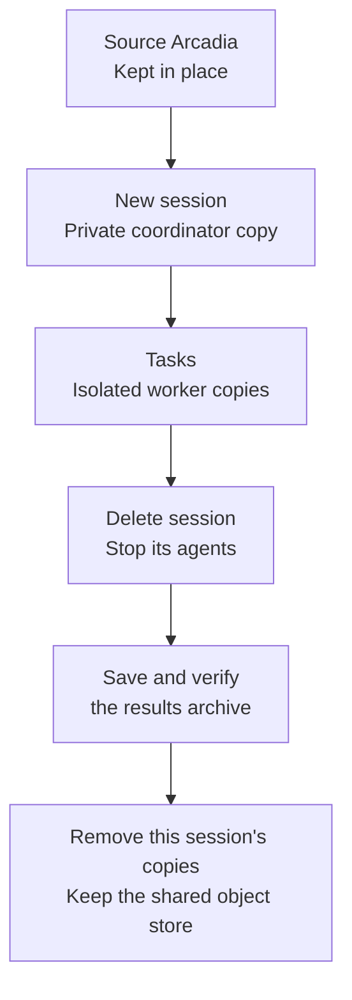

[English](en.md) · [Русский](ru.md) · [All guides](../index/en.md)

# Arcadia and Tracker

Choose `arcadia` during installation. Arc, Arcanum CLI and the corporate lease helper must be installed and authenticated on the server.

For an existing managed installation, pause work first and rerun the installer with the complete current module list plus `arcadia`. For example, for an installation that otherwise has only Codex and GitHub:

```bash
curl -fsSL https://github.com/heesooyaam/daddyloop/releases/download/v0.20.3/install.sh \
  | bash -s -- --yes --modules codex,github,arcadia
```

If `daddy` is a user-owned wrapper that runs a source checkout, do not replace that command with the installer. Update the checkout to a verified version first, then enable the complete module set without reinstalling or restarting the service:

```bash
daddy init --yes --no-service --modules codex,github,arcadia
```

After installing the dependencies and running `daddy arcadia setup`, obtain separate approval for `daddy restart`. The running service reads the new module set only after that restart.

Install the supported Arcanum CLI from the internal npm registry. The similarly named script in the `arcanum` skill is not a replacement for this binary:

```bash
npm install -g --registry https://npm.yandex-team.ru/ @yandex-tools/ai-arcanum-cli
```

Before installing SkillStore, look for an existing helper. Check the saved `arcadia.leaseHelper`, `command -v arcadia-mount-lease`, the standard `~/.agents/skills`, `~/.codex/skills`, `~/.claude/skills` and `~/.cursor/skills` directories, and the file beside the Arcadia source. The last option is shown below:

```bash
source="$HOME/arcadia2"
helper="$source/ai/artifacts/skills/community/arcadia-mounts/scripts/arcadia-mount-lease"
test -f "$helper"
bash "$helper" --json status
arc mount -l --json
```

A successful `status` confirms that the helper works. If a discovered helper fails, preserve its diagnostic output, fix the reported cause—for example, the path from `ARCADIA_MOUNT_CONFIG`—and retry the same command. Do not install a second copy of the skill to fix the configuration of a helper that was already found.

In the separate Arc output, find an entry whose `mount` is `$HOME/arcadia2` and whose `status` is `mounted`. The source does not have to appear in the helper lease inventory. If both checks pass, connect the existing helper directly:

```bash
source="$HOME/arcadia2"
helper="$source/ai/artifacts/skills/community/arcadia-mounts/scripts/arcadia-mount-lease"
daddy arcadia setup --workspace ~/arcadia2 --lease-helper "$helper"
```

Only if no helper was found through any of those locations, install the corporate `arcadia-mounts` skill. Complete the required bootstrap and `--agent-check` from the [SkillStore instructions](https://skillstore.yandex-team.ru/install/instruction.md) first. Then choose one skill directory and use it for both Store and `arcadia-mounts`:

```bash
SKILLS_DIR="$HOME/.codex/skills"
bash ~/.skillstore/store-install.sh --download-only --target-dir "$SKILLS_DIR"
bash "$SKILLS_DIR/store/scripts/store.sh" install arcadia-mounts --skills-root "$SKILLS_DIR"
```

If SkillStore is already installed, skip `--download-only` and set `SKILLS_DIR` to the directory previously passed as `--target-dir`.

If the helper works but the source has no `status: mounted`, SkillStore cannot fix the source: mount the source Arcadia first, then retry `setup`.

After installing the skill, run `daddy arcadia setup --workspace ~/arcadia2`. The command finds the helper on `PATH` and in the standard skill directories. You can also pass its exact path with `--lease-helper`. daddyloop invokes the helper through Bash, so it does not need an executable bit.

For Arcanum, daddyloop checks `ARC_TOKEN`, `ARC_OAUTH_TOKEN`, `~/.tokens/arcadia`, and the standard `~/.arc/token`, in that order. Setup verifies Arcanum read access without copying or changing credentials.

```bash
daddy workspaces add ~/arcadia2 --name Work --base trunk --copies session
daddy new --workspace Work "TEAM-123"
```

`setup` checks the helper, the mounted source, Arc and a read-only Arcanum request before enabling the integration. A missing dependency stops setup with a specific error.

Already have Work? Update its defaults with `daddy workspaces set Work ~/arcadia2 --copies session`. Existing sessions keep their settings.

## Agent instructions

Codex reads the global `~/.codex/AGENTS.md` and applicable `AGENTS.md` files from the repository root to the starting subdirectory. If Arcadia rules live below the root, save that directory as the workspace or session `scope`. Personal files from another machine are not transferred automatically.

Session skills are selected separately for daddy and workers. You can give the Arc VCS skill to both roles. The service needs `arcadia-mounts` as an installed helper; agents do not need to lease another checkout on top of the one already assigned to them. Skills neither enable the repository module nor install their scripts; see [instructions and skills](../instructions/en.md).

## Automatic copies

**Choose the source once. The service creates the working copies.** An Arcadia source must be mounted; it can use an older, separate object store. New copies always use the shared object store from `arcadia-mount-lease` configuration.



The session copy is prepared even before its first message. Independent workers have separate copies. The service owns the leases and switches branches; the agents use their supplied folders. You do not need to find a free `arcadia2`, `arcadia3`, etc.

On the website, **Create copies for this session automatically** is enabled by default. Telegram shows the mode before **Start session**. `--copies pool` selects the existing numbered mount pool instead; those copies are retained, and borrowed leases must be released separately.

Owned copies live under `<data-dir>/arcadia-sessions/<session-id>/`. Finished tasks can have their FUSE processes stopped to save memory; their stores and changes remain and are mounted again when needed. Source folders and copies owned by other sessions are not changed.


## Delete a session

Use **Delete session** on the website or session card in Telegram. The terminal has `/delete`; the plain CLI shows a confirmation before the destructive step:

```bash
daddy delete SESSION_ID
daddy delete SESSION_ID --yes
```

Deletion runs in the background:

1. Cancel and wait for this session's agent runs.
2. Save conversation, task data, patches and changed files in `<data-dir>/session-archives/<session-id>/g<generation>/`.
3. Verify the archive and ownership, then unmount and forget only the session's copies.

If export or ownership verification fails, deletion stops with the remaining copies preserved. Retry from the session card after addressing the reported problem. The source repository and shared object store remain. Telegram closes the session topic while keeping its messages.

The readable archive contains `session.json` and `arcadia/<task>/<role>/` with patches, file contents and `state.json`. It is also included in a full [backup](../backups/en.md). The service never force-unmounts or truncates the shared store.

## Tickets and reviews

Tracker credentials come from `TRACKER_OAUTH_TOKEN`, `TRACKER_TOKEN` or `~/.tokens/tracker`. Import reads the ticket; it does not post comments to Tracker. Native reviews use Arcanum and Arc tools.

```bash
daddy talk SESSION_ID "Also take TEAM-124"
daddy arcadia mounts
```

Tasks follow [the same review cycle](../tasks/en.md). Submission checks the lease owner, branch and exact revision. Use [operations](../operations/en.md) for cache management.
