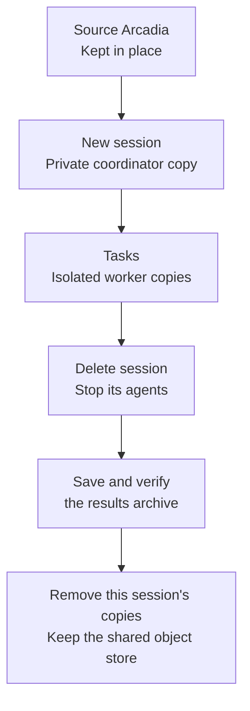
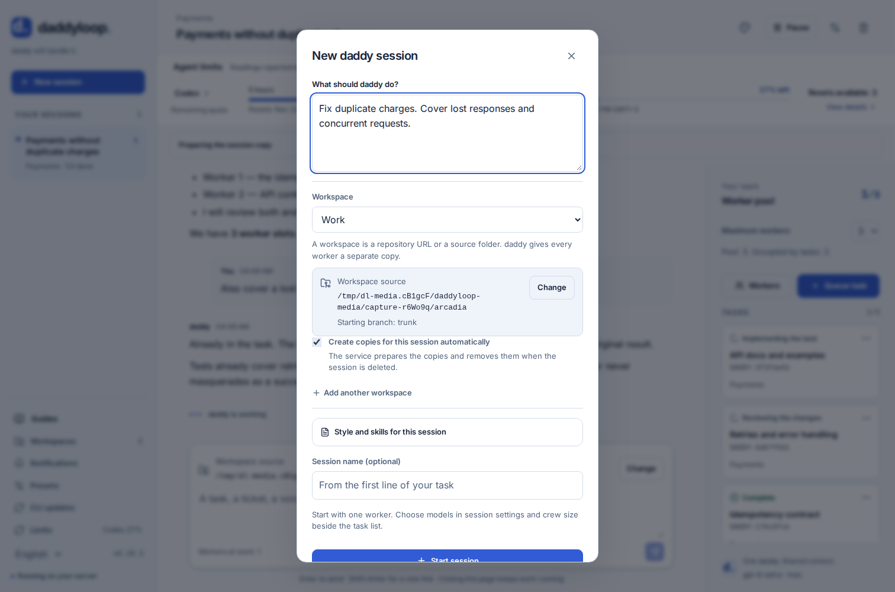

[English](en.md) · [Русский](ru.md) · [All guides](../index/en.md)

# Arcadia and Tracker

Arc, Arcanum CLI and the corporate lease helper must be installed and authenticated on the server.

The newest published release, [v0.20.3](https://github.com/heesooyaam/daddyloop/releases/tag/v0.20.3), predates the [setup fixes from PR #37](https://github.com/heesooyaam/daddyloop/pull/37). To use this guide today, build from a verified source revision containing those fixes. In that checkout, use Node 24, run `ONNXRUNTIME_NODE_INSTALL_CUDA=skip npm ci --include=dev` and `npm run build`, and use `scripts/daddy.mjs` from that checkout as `daddy`. If you already use a source wrapper, keep it and update the checkout it runs.

For an existing managed installation, wait for a [release](https://github.com/heesooyaam/daddyloop/releases) that includes the setup fixes. Then pause work, set `release_tag` to that release's actual tag, and use the full current module list plus `arcadia`. For example, for an installation with Codex and GitHub:

```bash
curl -fsSL "https://github.com/heesooyaam/daddyloop/releases/download/${release_tag:?set a supported release tag}/install.sh" \
  | bash -s -- --no-setup --modules codex,github,arcadia
```

For either installation path, enable the complete module set without restarting the service:

```bash
daddy init --yes --no-service --modules codex,github,arcadia
```

For a first connection with the module disabled, there are no old Arc workers: install the dependencies, run `daddy arcadia setup`, then obtain separate approval for `daddy restart`. The running service reads the new module set only after that restart.

If Arcadia is already enabled and a source update changes the helper, pause the Arc sessions and prevent new work from starting first. Wait for operations from the old version to finish, then perform the agreed service restart onto the verified new version while retaining the old helper. Only then run `setup` with the new helper, check `daddy arcadia mounts` and the saved journals, and resume the sessions. Do not change the helper while the old service can still allocate a copy.

Use the Arcanum client distributed through `ya`. Run this as the service user:

```bash
ya tool --print-path gena-arcanum-cli
```

Set `arcadia.arcanumCli` in the service's `config.json` to the absolute executable path printed by the command. Keep the other settings in the `arcadia` object. The similarly named script from the `arcanum` skill is a separate tool.

After enabling the module, first check the helper selection in the same environment used by the service:

```bash
daddy arcadia mounts
```

A successful call confirms that a helper is already selected. Check the Arcadia source separately with `arc mount -l --json`. If the entry whose `mount` is `$HOME/arcadia2` has `status` set to `mounted`, assign the selected value from the configuration, environment variable or `PATH` to `helper`. Check for a file with that name in the current directory first. Only use `command -v` for a bare name when no such file exists:

```bash
: "${helper:?set helper to the discovered value}" &&
if [ -f "$helper" ]; then
  helper="$(realpath "$helper")"
else
  helper="$(command -v "$helper")" &&
    helper="$(realpath "$helper")"
fi &&
  test -f "$helper" &&
  daddy arcadia setup --workspace ~/arcadia2 --lease-helper "$helper" &&
  (cd /tmp && daddy arcadia mounts)
```

Do not run `setup` without an explicit path at this step: the option saves an absolute name. The final `mounts` must return the original inventory after the working directory changes; it is skipped when `setup` fails.

If `daddy arcadia mounts` fails, check the saved `arcadia.leaseHelper`, then `DADDYLOOP_ARCADIA_LEASE_HELPER`, `command -v arcadia-mount-lease`, the standard `~/.agents/skills`, `~/.codex/skills`, `~/.claude/skills` and `~/.cursor/skills` directories, and the file beside the Arcadia source. The last option is shown below:

```bash
source="$HOME/arcadia2"
helper="$source/ai/artifacts/skills/community/arcadia-mounts/scripts/arcadia-mount-lease"
test -f "$helper"
if [ -x "$helper" ]; then
  "$helper" --json status
else
  bash "$helper" --json status
fi
arc mount -l --json
```

A successful `status` confirms that the helper works. If a discovered helper fails, preserve its diagnostic output, fix the reported cause—for example, the path from `ARCADIA_MOUNT_CONFIG`—and retry the same command. Do not install a second copy of the skill to fix the configuration of a helper that was already found.

The source does not have to appear in the helper lease inventory. If the helper was found manually and the source Arcadia is mounted, connect it directly:

```bash
source="$HOME/arcadia2" &&
  helper="$source/ai/artifacts/skills/community/arcadia-mounts/scripts/arcadia-mount-lease" &&
  helper="$(realpath "$helper")" &&
  test -f "$helper" &&
  daddy arcadia setup --workspace ~/arcadia2 --lease-helper "$helper" &&
  (cd /tmp && daddy arcadia mounts)
```

Only if the service has not selected a helper and none was found through those locations, install the corporate `arcadia-mounts` skill. Complete the required bootstrap and `--agent-check` from the [SkillStore instructions](https://skillstore.yandex-team.ru/install/instruction.md) first. Then choose one skill directory and use it for both Store and `arcadia-mounts`:

```bash
SKILLS_DIR="$HOME/.codex/skills"
bash ~/.skillstore/store-install.sh --download-only --target-dir "$SKILLS_DIR"
bash "$SKILLS_DIR/store/scripts/store.sh" install arcadia-mounts --skills-root "$SKILLS_DIR"
```

If SkillStore is already installed, skip `--download-only` and set `SKILLS_DIR` to the directory previously passed as `--target-dir`.

If the helper works but the source has no `status: mounted`, SkillStore cannot fix the source: mount the source Arcadia first, then retry `setup`.

After installing the skill, save its absolute path as well. Do not change the selected `SKILLS_DIR`; in a new shell, restore the same value used for `--download-only` first:

```bash
: "${SKILLS_DIR:?restore the previous SKILLS_DIR}" &&
  helper="$(realpath "$SKILLS_DIR/arcadia-mounts/scripts/arcadia-mount-lease")" &&
  test -f "$helper" &&
  daddy arcadia setup --workspace ~/arcadia2 --lease-helper "$helper" &&
  (cd /tmp && daddy arcadia mounts)
```

daddyloop runs executable lease helpers directly, using their declared interpreter. A Bash lease helper without the executable bit runs through Bash.

For Arcanum, daddyloop checks `ARC_TOKEN`, `ARC_OAUTH_TOKEN`, `~/.tokens/arcadia`, and the standard `~/.arc/token`, in that order. Setup verifies Arcanum read access without copying or changing credentials.

```bash
daddy workspaces add ~/arcadia2 --name Work --base trunk --copies session
daddy new --workspace Work "TEAM-123"
```

`setup` checks the helper, the mounted source, Arc and a read-only Arcanum request before enabling the integration. A missing dependency stops setup with a specific error.

Already have Work? Update its defaults with `daddy workspaces set Work ~/arcadia2 --copies session`. Existing sessions keep their settings.

## Agent instructions

Codex reads the global `~/.codex/AGENTS.md` and applicable `AGENTS.md` files from the repository root to the starting subdirectory. If Arcadia rules live below the root, save that directory as the workspace or session `scope`. Personal files from another machine are not transferred automatically.

When Codex starts in an Arcadia subdirectory, the detected project root determines which parent `AGENTS.md` files it reads. If Codex starts its search at the subdirectory or treats an enclosing project as the root, add `.arc` to the top-level `project_root_markers` in the service user's `~/.codex/config.toml` (or in the configured `CODEX_HOME`). This marks the Arcadia checkout as the boundary for project instructions. Keep all existing markers. If you use the default Git marker, the top-level setting is:

```toml
project_root_markers = [".git", ".arc"]
```

If Codex starts at the Arcadia root itself, it can read the root's `AGENTS.md` without this setting. See [Codex instruction discovery](https://developers.openai.com/codex/guides/agents-md).

Session skills are selected separately for daddy and workers. You can give the Arc VCS skill to both roles. The service needs `arcadia-mounts` as an installed helper; agents do not need to lease another checkout on top of the one already assigned to them. Skills neither enable the repository module nor install their scripts; see [instructions and skills](../instructions/en.md).

## Automatic copies

**Choose the source once. The service creates the working copies.** An Arcadia source must be mounted; it can use an older, separate object store. New copies always use the shared object store from `arcadia-mount-lease` configuration.



The session copy is prepared even before its first message. Independent workers have separate copies. The service owns the leases and switches branches; the agents use their supplied folders. You do not need to find a free `arcadia2`, `arcadia3`, etc.

On the website, **Create copies for this session automatically** is enabled by default. Telegram shows the mode before **Start session**. `--copies pool` selects the existing numbered mount pool instead; those copies are retained, and borrowed leases must be released separately.

Owned copies live under `<data-dir>/arcadia-sessions/<session-id>/`. Finished tasks can have their FUSE processes stopped to save memory; their stores and changes remain and are mounted again when needed. Source folders and copies owned by other sessions are not changed.



## Delete a session

Use **Delete session** on the website or session card in Telegram. The terminal has `/delete`; the plain CLI shows a confirmation before the destructive step:

```bash
daddy delete SESSION_ID
daddy delete SESSION_ID --yes
```

Deletion runs in the background:

1. Cancel and wait for this session's agent runs.
2. Save conversation, task data, patches and changed files in `<data-dir>/session-archives/<session-id>/g<generation>/`.
3. Verify the archive and ownership, then unmount and forget only the session's copies.

If export or ownership verification fails, deletion stops with the remaining copies preserved. Retry from the session card after addressing the reported problem. The source repository and shared object store remain. Telegram closes the session topic while keeping its messages.

The readable archive contains `session.json` and `arcadia/<task>/<role>/` with patches, file contents and `state.json`. It is also included in a full [backup](../backups/en.md). The service never force-unmounts or truncates the shared store.

## Tickets and reviews

Tracker credentials come from `TRACKER_OAUTH_TOKEN`, `TRACKER_TOKEN` or `~/.tokens/tracker`. Import reads the ticket; it does not post comments to Tracker. Native reviews use Arcanum and Arc tools.

```bash
daddy talk SESSION_ID "Also take TEAM-124"
daddy arcadia mounts
```

Tasks follow [the same review cycle](../tasks/en.md). Submission checks the lease owner, branch and exact revision. Use [operations](../operations/en.md) for cache management.
