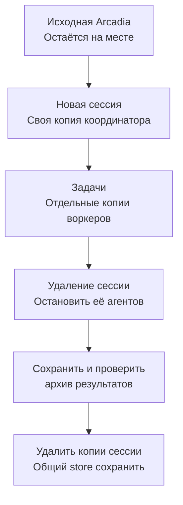
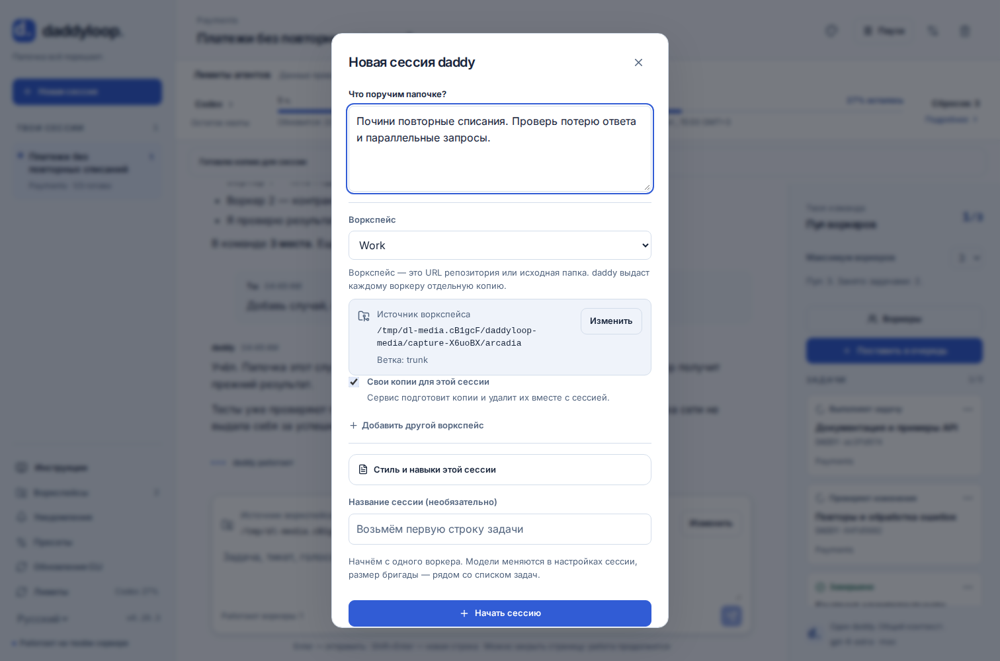

[English](en.md) · [Русский](ru.md) · [Все инструкции](../index/ru.md)

# Arcadia и Tracker

При установке выбери `arcadia`. На сервере должны быть установлены и авторизованы Arc, Arcanum CLI и корпоративный helper для аренды копий.

Для существующей управляемой установки сначала приостанови работу и повтори установку с полным текущим списком модулей и `arcadia`. Например, для установки только с Codex и GitHub:

```bash
curl -fsSL https://github.com/heesooyaam/daddyloop/releases/download/v0.20.3/install.sh \
  | bash -s -- --yes --modules codex,github,arcadia
```

Если `daddy` запускается пользовательским скриптом из исходников, не заменяй этот скрипт установщиком. Сначала обнови исходники до проверенной версии, затем включи полный набор модулей без переустановки и перезапуска службы:

```bash
daddy init --yes --no-service --modules codex,github,arcadia
```

После установки зависимостей и `daddy arcadia setup` отдельно согласуй `daddy restart`. Работающая служба прочитает новый набор модулей только после этого перезапуска.

Поставь штатный Arcanum CLI из внутреннего npm-реестра. Одноимённый скрипт из навыка `arcanum` не заменяет этот бинарь:

```bash
npm install -g --registry https://npm.yandex-team.ru/ @yandex-tools/ai-arcanum-cli
```

После включения модуля сначала проверь выбор helper в том же окружении, в котором работает служба:

```bash
daddy arcadia mounts
```

Успешный вызов подтверждает, что helper уже выбран. Отдельно проверь исходную Arcadia через `arc mount -l --json`. Если запись с `mount` равным `$HOME/arcadia2` имеет `status` равный `mounted`, возьми выбранный путь из настройки, переменной окружения или `PATH`. Для относительного пути выполни `realpath` из каталога, где прошёл `mounts`, и подставь результат в показанную ниже форму с `--lease-helper`. Не запускай на этом шаге `setup` без явного пути: флаг сохраняет абсолютное имя, которое останется рабочим после смены каталога.

Если `daddy arcadia mounts` завершился с ошибкой, проверь по порядку сохранённый `arcadia.leaseHelper`, переменную `DADDYLOOP_ARCADIA_LEASE_HELPER`, команду `command -v arcadia-mount-lease`, стандартные каталоги `~/.agents/skills`, `~/.codex/skills`, `~/.claude/skills`, `~/.cursor/skills` и файл рядом с исходной Arcadia. Ниже показан последний вариант:

```bash
source="$HOME/arcadia2"
helper="$source/ai/artifacts/skills/community/arcadia-mounts/scripts/arcadia-mount-lease"
test -f "$helper"
bash "$helper" --json status
arc mount -l --json
```

Успешный `status` подтверждает работу helper. Если найденный helper завершился с ошибкой, сохрани его диагностику, исправь указанную причину — например, путь из `ARCADIA_MOUNT_CONFIG` — и повтори ту же команду. Не устанавливай вторую копию навыка для исправления конфигурации уже найденного helper.

Источник не обязан входить в список аренды helper. Если helper найден вручную и исходная Arcadia смонтирована, подключи его напрямую:

```bash
source="$HOME/arcadia2"
helper="$source/ai/artifacts/skills/community/arcadia-mounts/scripts/arcadia-mount-lease"
helper="$(realpath "$helper")"
daddy arcadia setup --workspace ~/arcadia2 --lease-helper "$helper"
```

Только если helper не выбран службой и не найден ни одним из перечисленных способов, установи корпоративный навык `arcadia-mounts`. Сначала выполни обязательные bootstrap и `--agent-check` из [инструкции SkillStore](https://skillstore.yandex-team.ru/install/instruction.md). Затем выбери каталог навыков один раз и используй его и для Store, и для `arcadia-mounts`:

```bash
SKILLS_DIR="$HOME/.codex/skills"
bash ~/.skillstore/store-install.sh --download-only --target-dir "$SKILLS_DIR"
bash "$SKILLS_DIR/store/scripts/store.sh" install arcadia-mounts --skills-root "$SKILLS_DIR"
```

Если SkillStore уже установлен, пропусти `--download-only` и укажи в `SKILLS_DIR` тот каталог, который раньше передавал как `--target-dir`.

Если helper работает, но у источника нет `status: mounted`, SkillStore это не исправит: сначала подключи исходную Arcadia, затем повтори `setup`.

После установки навыка также сохрани его абсолютный путь:

```bash
SKILLS_DIR="$HOME/.codex/skills"
helper="$(realpath "$SKILLS_DIR/arcadia-mounts/scripts/arcadia-mount-lease")"
daddy arcadia setup --workspace ~/arcadia2 --lease-helper "$helper"
```

Helper запускается через Bash, поэтому исполняемый бит ему не нужен.

Для Arcanum daddyloop использует, по порядку, `ARC_TOKEN`, `ARC_OAUTH_TOKEN`, `~/.tokens/arcadia` или штатный `~/.arc/token`. Настройка проверяет чтение Arcanum, но не копирует и не меняет учётные данные.

```bash
daddy workspaces add ~/arcadia2 --name Work --base trunk --copies session
daddy new --workspace Work "TEAM-123"
```

`setup` проверяет helper, подключённый источник, Arc и запрос Arcanum только на чтение до включения интеграции. Отсутствующая зависимость останавливает настройку с конкретной ошибкой.

Work уже есть? Обнови дефолты: `daddy workspaces set Work ~/arcadia2 --copies session`. Существующие сессии сохранят свои настройки.

## Инструкции агентов

Codex читает глобальный `~/.codex/AGENTS.md` и подходящие `AGENTS.md` от корня репозитория до стартовой подпапки. Если правила лежат ниже корня Arcadia, сохрани эту подпапку как `scope` воркспейса или сессии. Личные файлы с другой машины автоматически не переносятся.

Навыки сессии выбираются отдельно для daddy и воркеров. Навык Arc для работы с VCS можно дать обеим ролям. `arcadia-mounts` нужен сервису как установленный helper; агентам не нужно арендовать ещё одну копию поверх уже выданной. Навыки не включают модуль репозитория и не устанавливают свои скрипты — см. [инструкции и навыки](../instructions/ru.md).

## Автоматические копии

**Выбери исходную папку один раз. Рабочие копии создаст сервис.** Исходная Arcadia должна быть подключена; она может использовать старое отдельное хранилище. Новые копии всегда используют общий store из конфигурации `arcadia-mount-lease`.



Копия сессии готовится ещё до первого сообщения. Независимые воркеры получают отдельные копии. Сервис занимает их и переключает ветки; агенты работают в выданных папках. Искать свободную `arcadia2`, `arcadia3` и так далее не нужно.

На сайте по умолчанию включена опция **Свои копии для этой сессии**. В Telegram режим показан перед кнопкой **Начать сессию**. `--copies pool` выбирает прежний пул нумерованных копий: они сохраняются, а занятые копии нужно освобождать отдельно.

Копии лежат в `<data-dir>/arcadia-sessions/<session-id>/`. У завершённых задач сервис может остановить процессы FUSE, чтобы освободить память. Хранилища и изменения остаются; при необходимости копии подключаются снова. Исходная папка и копии других сессий сохраняются.



## Удалить сессию

Нажми **Удалить сессию** на сайте или в карточке Telegram. В терминале есть `/delete`; обычный CLI сначала показывает, что будет удалено:

```bash
daddy delete SESSION_ID
daddy delete SESSION_ID --yes
```

Удаление проходит в фоне:

1. Отменить запуски этой сессии и дождаться их остановки.
2. Сохранить разговор, данные задач, патчи и изменённые файлы в `<data-dir>/session-archives/<session-id>/g<generation>/`.
3. Проверить архив и владельца копий, затем отключить и удалить только копии этой сессии.

Если сохранить данные или проверить владельца не удалось, удаление остановится. Оставшиеся копии сохранятся. После решения указанной проблемы можно повторить удаление из карточки сессии. Исходный репозиторий и общий store остаются. Тема Telegram закрывается, сообщения в ней сохраняются.

В архиве лежат `session.json` и `arcadia/<task>/<role>/`: патчи, содержимое файлов и `state.json`. Этот архив также входит в полный [бекап](../backups/ru.md). Сервис не отключает занятые копии принудительно и не обрезает общий store.

## Тикеты и ревью

Токен Tracker читается из `TRACKER_OAUTH_TOKEN`, `TRACKER_TOKEN` или `~/.tokens/tracker`. Импорт читает тикет; комментарии в Tracker не публикуются. Ревью работает через Arcanum и Arc.

```bash
daddy talk SESSION_ID "Возьми ещё TEAM-124"
daddy arcadia mounts
```

Задачи проходят [обычный цикл ревью](../tasks/ru.md). Перед отправкой проверяются владелец копии, ветка и точная ревизия. Управление кешем описано в [обслуживании](../operations/ru.md).
