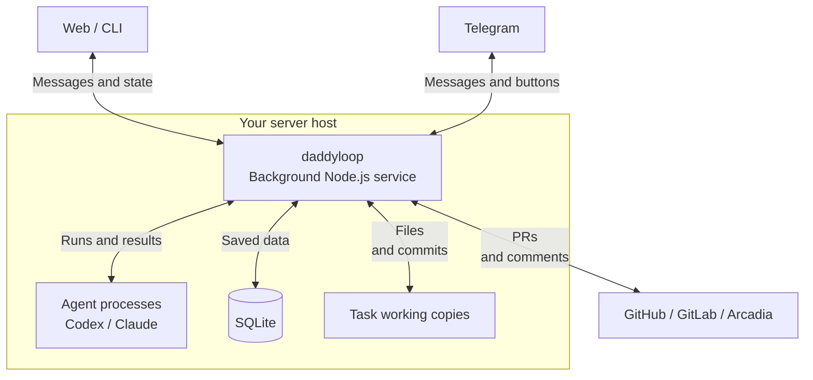
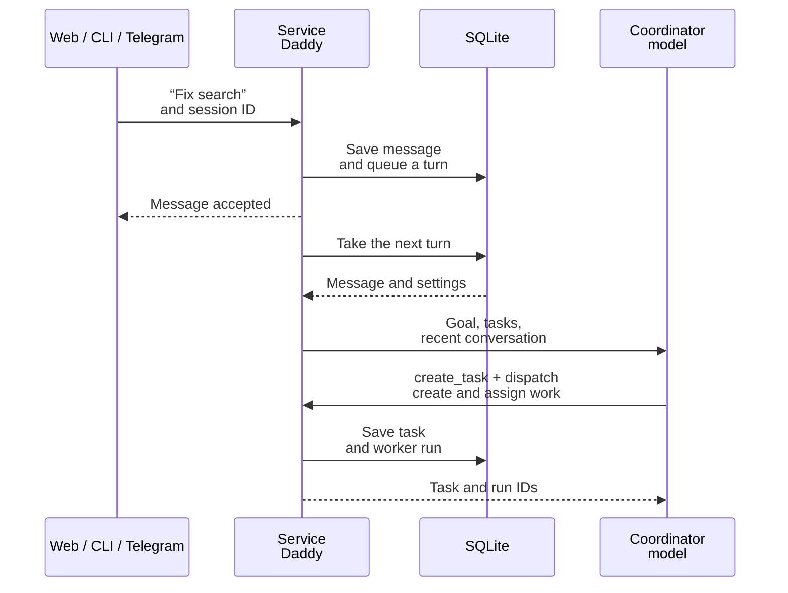
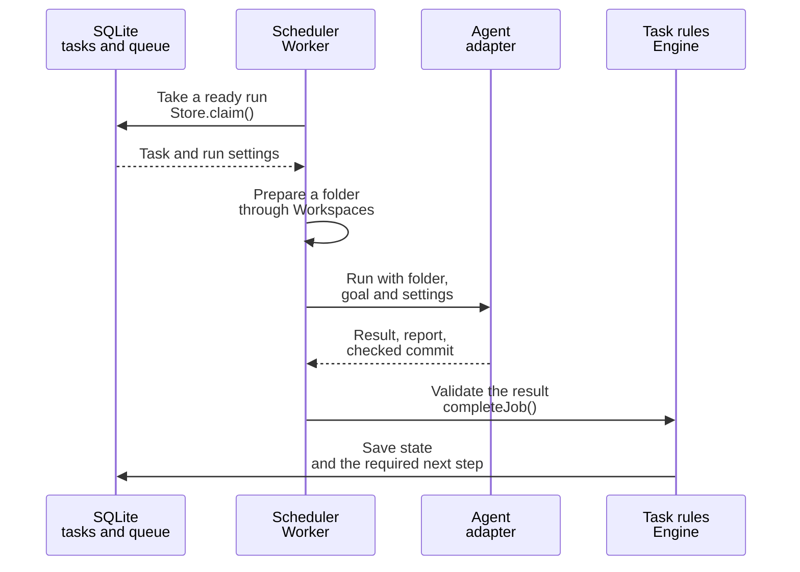
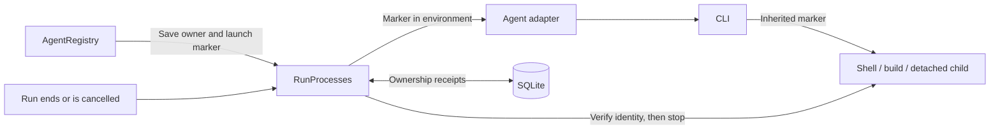
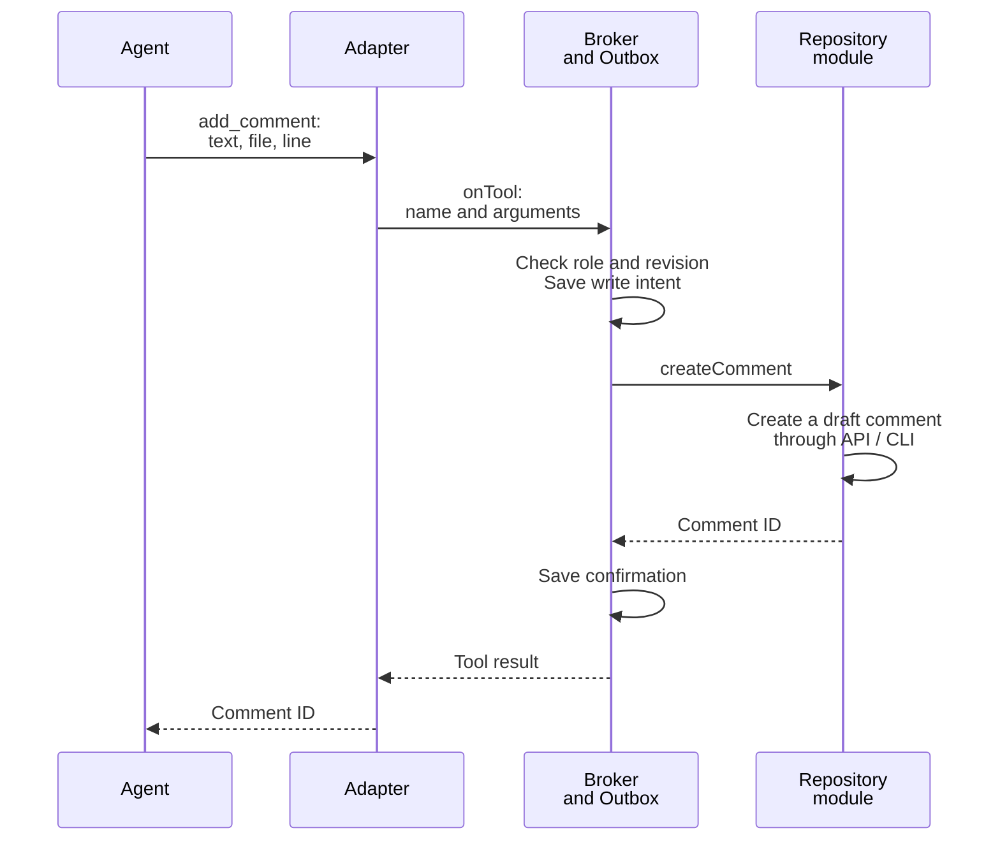
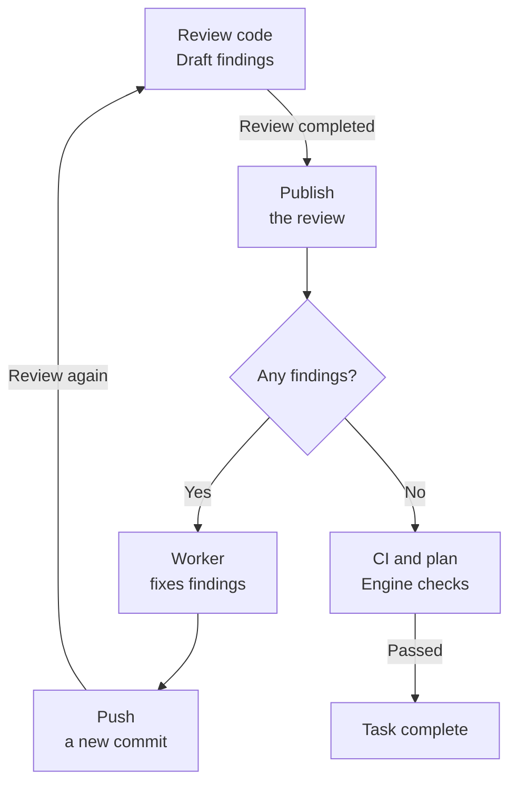
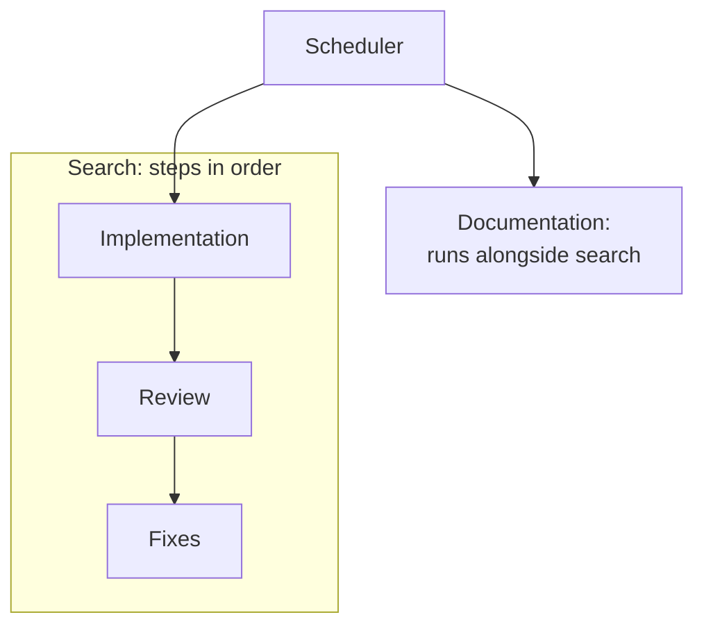
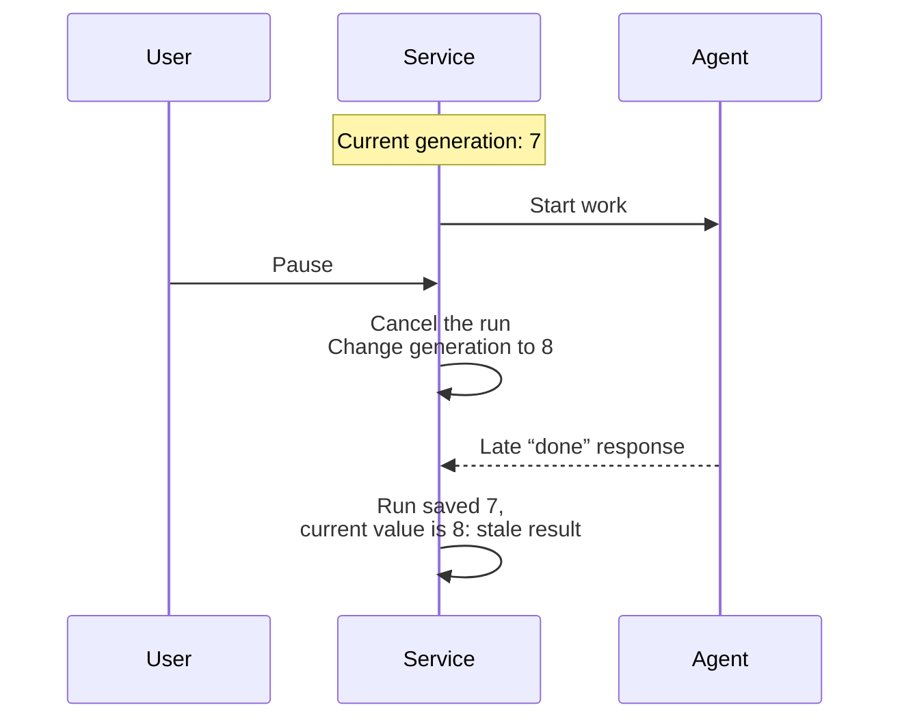

[English](en.md) · [Русский](ru.md) · [All guides](../index/en.md)

# How daddyloop works

Start with the overview, then follow [task creation](#1-how-a-message-becomes-a-task), [agent execution](#2-how-an-agent-starts), [tools and adapters](#3-how-an-agent-calls-tools), [the review loop](#4-how-the-review-loop-closes), [parallel work](#5-which-runs-can-work-in-parallel) and [cancellation and recovery](#6-how-cancellation-blocks-old-results).

## The big picture

You set the goal. daddy assigns work to workers and reviews the result. The application starts agents, saves history and sends findings back for correction.

For example, “Fix search” goes through implementation → review → fixes → another check. Below, we follow that task from the first message to the result.



**The website, CLI and Telegram control one service on the server.** Closing your laptop leaves the service and agents running. Connection options are covered in [web access](../web/en.md).

Inside the service, `Daddy`, `Worker`, `Engine` and the other components are objects in one Node.js process. They call each other's methods. Codex and Claude run as separate processes; adapters handle their protocols.

## 1. How a message becomes a task

The service saves the message first. It then starts one coordinator turn: a model run that handles the request. The model can answer you or assign work.



The website and CLI send text over HTTP. Regular Telegram messages call the same `Daddy.chat()`. “Accepted” means the request is saved. The model's answer arrives later. The web client fetches updates about every two seconds.

**Queue task** on the website and `/task` in Telegram call the same service operation. It saves the task and its first author run together. A retry with the same request ID finds the same task. The dispatcher can start the run as soon as a worker is available. Both interfaces show the same task IDs and worker assignments.

Direct queueing starts a read-only architecture check by default. The planner validates the ticket against the repository and returns a Markdown plan for the pinned base. The engine stores the plan and queues implementation in one transaction. A stale or incomplete plan cannot advance the task. The coordinator path records the agreed coding brief in the GitHub issue first and starts implementation directly unless a separate plan check was requested. See [task controls](../tasks/en.md#architecture-before-implementation).

A plan uses the task architect override, then the session architect override, then the session reviewer profile. The worker slot selects the developer profile independently. Compatible planning and implementation turns resume the same task thread with their own per-turn permissions. A legacy planner-only thread can finish its clarification, and an incompatible engine receives the saved plan in its own context. See [queue selection](../../src/core/store.ts) and [native thread selection](../../src/modules/agents/registry.ts).

The coordinator receives the goal, task board and recent messages. It uses tools to read older conversation or task details. For example, `create_task` creates “Fix search” and `dispatch` assigns implementation. The service first checks the selected workspace, the task's session and its dependencies.

When a worker finishes, an event queues another coordinator turn. That is how it learns about the result and can assign more work or ask you a question.

Code: [HTTP request handling](../../src/server/daddy.ts), [Daddy.chat(), tick(), onEvent() and tool checks](../../src/core/daddy.ts), [tasks from text and tickets](../../src/core/ticket-workflow.ts).

Saved conversation messages feed all clients and the linked Telegram topic. `onAssistantMessage` carries completed public text blocks during a coordinator turn; diagnostics and tools use separate events. The host checks the run generation before saving public text. Telegram records the source of a user message to avoid echoing it into its original topic.

## 2. How an agent starts

A **session** is a conversation with daddy and all its tasks. A **task** is one result, such as working search. A **run** is one step: implement it, review it or address findings. One task can have many runs.

The scheduler finds a ready run in the queue, checks capacity and resources, then prepares a folder and calls the agent. This scheduler is named `Worker` in code; it starts models for both roles.



**Folder.** A named workspace points to the source repository and allowed scope. `Workspaces` prepares separate task copies; `ArcWorkspaces` handles Arcadia. In automatic mode the repository module prepares a session copy before the first model turn, then allocates workers their own copies. A worker changes its own copy, while the reviewer reads a pinned code version. Coordination has its own `DaddyWorkspace` copy. The user's source checkout is not switched, and uncommitted changes are preserved.

For a Git URL, the hosting module validates the address and supplies authentication through `GitRepositoryTransport`. `Workspaces` asks Git for the default branch and commit, fetches that commit into a task-owned Git database, then creates a worktree. The next task gets a separate database and branch; retries reuse the existing copy. A local Git source is read without fetching into it. [The source-to-copy diagram](../workspaces/en.md#one-source-separate-workers) shows the separation.

**Settings.** The agent profile and instructions are saved with the queued run. The first dispatch in a session applies any explicit task or worker profile and saves the selected profile with the run. A session-wide worker profile replaces slot overrides and applies to queued author turns. An active worker turn finishes on its current profile. `AgentRegistry` selects the adapter by `profile.engine`.

**Result.** The agent returns a status, report and the commit it worked against. `Engine` checks these against the task and repository. A “done” message is insufficient: an unfinished review, for example, leaves the task open.

The saved objects are `ReviewGroup` (session), `Task` (task), `Job` (task run) and `DaddyJob` (coordinator turn).

Code: [Worker](../../src/runtime/worker.ts), [Store](../../src/core/store.ts), [data types](../../src/core/types.ts), [Git copies](../../src/runtime/workspaces.ts), [Arc copies](../../src/runtime/arc-workspaces.ts), [coordinator copy](../../src/runtime/daddy-workspace.ts).

### Who stops a build when a run ends



Closing the CLI alone is insufficient: a background build can detach and keep its working copy busy. The host records ownership before launch. Both adapters pass that marker to commands, so the host can find descendants even after their original parent exits. On completion, failure or cancellation it sends SIGTERM, waits briefly, then uses SIGKILL if necessary. It checks the user, host boot and process start time before signalling. Surviving processes are recorded as still stopping; their files remain intact.

Recovery retries verified leftovers before asking a model for a cleanup plan. It can remove disposable run caches after their processes stop; active runs and redirected or mounted cache paths are protected. Startup recovers abandoned run ownership before scheduling new work. See [RunProcesses](../../src/runtime/run-processes.ts), [adapter contract](../module-development/en.md) and [lifecycle tests](../../tests/run-processes.test.ts).

## 3. How an agent calls tools

Suppose the reviewer finds a bug and wants to leave a comment. It sends the application a command with the text and code location. This is the command's path:



`Broker` checks that the run is still valid, the code is unchanged and the role may call this command. A worker cannot create review comments or verify its own fix. The response — a comment ID or an error — returns to the agent through the same path. Comment Markdown is preserved.

`Outbox` handles lost responses. **If the provider creates a comment and the connection breaks, creating another comment immediately would be wrong.** The service records the operation ID and arguments before writing, then looks for an existing result. If it cannot establish the outcome, it stops the retry for inspection.

The adapter translates this shared exchange into the selected CLI's protocol. For Codex, JSON requests and responses travel through the process's standard input and output: app-server JSON-RPC. Claude uses Agent SDK `query()` and MCP tools. The rest of the application receives the same calls and results.

The common runtime interface from [runtime/agent.ts](../../src/runtime/agent.ts):

```ts
export interface AgentRuntime {
  run(input: AgentInput): Promise<AgentResult>;
}
export interface SessionRuntime {
  runSession(input: SessionInput): Promise<AgentResult>;
}
```

`run()` performs a task step; `runSession()` performs a coordinator turn. Inputs include a folder, goal, profile, instructions, tools and cancellation signal. The output is a result; `onTool`, `onEvent` and `onSession` callbacks carry commands, progress and the conversation ID for resuming later.

`RepositoryRegistry` selects the repository module: `ReviewProvider` handles comments and `SubmissionBackend` creates PRs. The model catalogue, usage and CLI updates also belong to the agent module. Full contracts and a registration example are in [Write a module](../module-development/en.md).

Code: [AgentRegistry](../../src/modules/agents/registry.ts), [Broker](../../src/core/broker.ts), [Outbox](../../src/core/outbox.ts), [RepositoryRegistry](../../src/modules/repositories/registry.ts).

## 4. How the review loop closes

The scheduler publishes a finished native review and pushes a saved worker commit. These steps do not need an extra coordinator turn. If automatic publication or push enters a state that needs a decision, the coordinator receives that transition. Independent review still runs on the resulting revision.

For a correction, the worker checks the behavior behind the published finding across affected entry points. A repeat reviewer can reuse verified coverage from the same target and an ancestor commit. The correction prompt includes related tasks and plans, the published feedback and the requested change. A full review is needed if the earlier baseline cannot be verified.

A finding describes the unmet acceptance criterion, related failures and a check that demonstrates the expected outcome. On a recurring criterion, or from the third review with previous findings, the reviewer saves the diagnosis and revised correction strategy in the native summary before adding a new finding. This happens in the existing review turn. The worker receives that summary after publication. The next reviewer receives a bounded excerpt of the worker report when the saved correction matches both the reviewed and corrected commits.

Work such as filing issues can produce a report with links and other evidence. When the task branch is still at its starting base, the service saves the report and queues an independent check by daddy. The task completes after the reviewer verifies the result against the original requirements. The run generation and pinned revision guard the result. daddy can then use the report to queue follow-up work.

When the task branch has saved changes relative to that base, the service sends them to a PR through `TicketWorkflow`. This includes commits preserved from an earlier run. You can also attach an existing PR directly. Both paths use the same review loop.



**From review to fixes.** The reviewer prepares native comments during a turn. When a GitHub review is incomplete, daddy can publish its confirmed findings on the original PR commit and assign the worker to address them. With auto-merge enabled, a confirmed merge conflict goes to the assigned worker first. The next commit still requires a full independent review. The coordinator can read the actual question using read_task.

**From a fix to another review.** Suppose a bug was found in commit H1 and the fix is saved in H2. After H2 is pushed, `Engine.completeJob()` makes the task ready for review. The scheduler starts it on the next pass. This transition closes the loop.

A request to message the worker during submission is stored with the task. After the saved commit is confirmed and its review is published, the scheduler delivers the instruction on the current revision. When a worker reports an incomplete fix without a human question and GitHub confirms a conflict, the service checkpoints the local edits, assigns conflict resolution to the same worker, and requires independent review of the resulting commit.

**Finishing.** The reviewer must account for earlier findings: verify the fix or record a decision to withdraw, defer or reject a finding. Completion then needs an empty published review and the task's required checks: CI and, for a plan, approval. For opted-in GitHub tasks the scheduler rechecks the published review, CI and PR revision before sending a merge request with the reviewed head SHA. An uncertain write is reconciled through the outbox. A confirmed merge conflict on an opted-in task queues an author run on the pinned PR and target commits. The service pushes the resulting two-parent commit to the same PR and queues independent review of the new revision.

The opening request includes whole decisions for the pinned revision and known findings. Their budget uses the space left after all required review text. Reviewers, including those verifying a merged PR, can use read_review_decisions to page through the task's journal by comment ID or commit. Codex discovers the read-only tool when starting or resuming a thread, independently of the native review tools stored in the thread. Authors can read decisions linked to the published feedback provided to them. SQLite filters the journal before reading a page. The tool caps each JSON response by its UTF-8 size. When a reason spans several pages, every fragment carries its decision ID, comment ID, and commit. If repeating the other fields leaves less than half a page for the reason, the tool returns the entire record as JSON fragments. Join their text and parse it when the record is complete. Follow the cursor until it is empty. See the [context selection and history reader](../../src/core/review-decisions.ts).

On a Codex review context overflow, the adapter resumes the same thread and requests history compaction. It waits for the compaction turn to finish before continuing the pinned review. The existing fresh-thread recovery for opted-in GitHub tasks remains available if the thread still cannot continue. Native drafts and the coordinator conversation are preserved. See the [Codex app-server compaction protocol](https://developers.openai.com/codex/app-server#trigger-thread-compaction).

After a saved fix is confirmed, a pending GitHub review on the previous head can block the next review. For opted-in tasks, the service archives its draft Markdown in SQLite before deletion. Replacement requires the same account, marker and revision, zero inline comments, and either the original placeholder or a summary matching a confirmed write receipt. Unrecognized edits stay on GitHub. The new draft is attached to the confirmed head and needs a full review.

With GitHub auto-merge enabled, successful review and checks move the task to `awaiting_merge`. The pool keeps the assigned worker through conflict repairs and releases the slot on confirmed completion. Dependent tasks wait for completion as well.

The service publishes a completed review and pushes the saved commit automatically after checking the PR revision. Incomplete checks and disputes leave the task open. Review continues while it makes progress. Repeated identical findings stop the cycle for a decision. Failing CI also keeps the task waiting and does not itself start a CI-fix run.

Code: [Engine transitions](../../src/core/engine.ts), [Worker scheduler](../../src/runtime/worker.ts), [PR submission](../../src/core/ticket-workflow.ts). The [loop tests](../../tests/worker.test.ts) cover review, fixes and another check.

The worker records a saved correction and its starting revision under the task lock. The service submits that exact commit and verifies the PR head before starting another review. A changed target or an unconfirmed submission leaves the task waiting with the saved commit ID. Earlier native drafts stay available for inspection.

For example, GitHub may still be calculating mergeability when findings are published. The service waits for the result. A confirmed conflict assigns one integration job to the existing worker. The same decision applies at review start and during the final merge check. With no conflict the author can address the published findings. A merge request requires a fresh published review with no findings and passing CI on the pinned revision. An uncertain previous write is reconciled with GitHub first.

[nextPrAction](../../src/core/pr-routing.ts) defines the order of decisions. [Engine](../../src/core/engine.ts) preserves drafts or local changes and assigns the worker. [Auto-merge](../../src/core/auto-merge.ts) consults the same rule after reading the review and immediately before writing to GitHub. The [regression tests](../../tests/auto-merge.test.ts) exercise the same conflict through different entry points.

A transient GitHub read failure is retried by the scheduler, with a persistent backoff. When a PR was already created the service records its URL, submitted commit and task generation and retries only the read needed to attach it. If the response to PR creation was lost, daddy searches for the original submission using its marker, branch and author before taking further action. The queue displays the retry time or an actual owner question.

Before creating a GitHub review draft, the service records its marker, account and PR revision. If GitHub returns HTTP 502, the scheduler waits and checks all pages for the original review, including submitted reviews. Empty lists and failed reads keep the intent pending. A new POST requires a confirmed refusal or an intent that has yet to send a request. The scheduler rechecks the account, target and revision before writing. A matching draft keeps its native ID. The service checks its contents before queueing the reviewer and again before starting the agent. A temporary 404 during either the review or comments read delays the same queued job. The service preserves edited or submitted reviews for inspection. After early publication, an explicit retry verifies the original review and PR target before starting a new round, assigning a conflict repair or verifying the merged result. Read-only merge verification saves an explicit request across transient failures and restarts while it resolves the creation intent. A confirmed refusal allows verification of the original merge target without an existing review. It checks the original account and target, uses the known ID when available, and leaves an unresolved intent open. A manual or resource pause during preparation preserves the job kind for an ordinary review or a merge verification. Merge verification retains the original review ID across temporary read failures and waits for CI or plan approval. It accepts a confirmed unchanged draft, or requires the reviewer to account for the published findings. The service checks the same review and the latest PR before completion. Conflict repairs reread the original publication by ID. For older tasks, a native review link or matching comment IDs can establish identity from SQLite publication events even after text edits. If the target base changed, the service first verifies that the same target branch advanced. After a confirmed advance of the same target branch, the reviewer checks the updated revision on the same PR head. Publication retries use the same review ID and compare its contents with the saved draft.

When a conflict repair times out, the same worker resumes in its existing checkout after 30 seconds, or after five minutes on subsequent timeouts. If the target branch advanced, the service verifies ancestry before continuing and reviews the result against the current base.

## 5. Which runs can work in parallel

**One task has at most one active agent run.** While a worker implements “Fix search,” a second run for that task waits. Another task — such as updating documentation — can run alongside it.



This prevents two runs from editing one working copy at once and starts review after the previous step finishes. **A task and a run are different:** a task might go through five runs over its lifetime, with only one active at a time.

`Store.claim()` enforces this by skipping tasks that already have a running job. Selecting a queued job and marking it as running are saved together. The database also rejects a second running job for the same task ID; that is what the `one_running_per_task` index does.

Two other limits apply. Reviews within one session run in order; its coordinator and reviewer cannot overlap either. They share a model profile but have separate conversation histories. A host-wide setting limits simultaneous task runs (`worker.maxAgents`, including reviews); separately, one coordinator turn may run at a time.

**Shrinking the pool waits for tasks to finish.** Changing its size from three to one preserves slots for assigned tasks. Those slots stay occupied through review, fixes and checks, even while paused. New tasks wait for room in the smaller pool. A dependency “A before B” also holds B, but does not transfer changes from A's branch into it.

Code: [job selection and duplicate prevention](../../src/core/store.ts), [worker pool](../../src/core/worker-pool.ts), [shared reviewer](../../src/runtime/worker.ts).

Workers keep their numbers while tasks occupy them. A request for a specific worker waits for that worker. A requested model and reasoning level use the first free worker with the same profile, or set that profile on the first free worker. A forced profile change cancels the active author attempt, advances the task generation and queues the same step in the existing working copy. The scheduler waits for that attempt to stop before starting its replacement.

## 6. How cancellation blocks old results

Pausing a session records which tasks and queued turns it stopped. Resume restores their previous states and queue order, including after a service restart. Tasks paused individually keep their pause. A worker resumes in its existing working copy, and an unfinished review still needs a completed reviewer result.

Cancellation can arrive while an agent is already sending its answer. Sending “stop” is therefore insufficient: the service must also check whether that old run may still change the task.



**An old result cannot advance the task.** The generation is a cancellation counter saved with each run. After a pause, the numbers differ. `Engine.completeJob()` ignores that result, and `Broker.call()` prevents that run from changing comments. Files and history are preserved.

If the target branch advances before or during a GitHub review, daddy can keep its draft on the same PR commit and immediately schedule a fresh review, including when auto-merge is off. The old result cannot release feedback. For a draft with findings it verifies the author, the recorded summary and each comment against confirmed review operations. The reviewer must check the complete change, update or withdraw the remaining findings and write a new summary before publication. Unrecognized edits stay in the draft for inspection.

After a pause due to resource pressure, the same recovery applies to an interrupted review once the task resumes. The task keeps its pinned base while resources are unavailable. For a task already pinned to a newer base, the service checks the recorded pause, resume and base changes. Before queuing a fresh review, it verifies that the same target branch advanced and that the draft still matches the latest confirmed summary and comments, including recorded deletions.

A worker can continue fixing published findings on its pinned PR commit when GitHub confirms a fast-forward of the same target branch. Before pushing, daddy checks the source and target again. The new commit gets an independent review. A coordinator question about an already blocked task stays in the session history and other tasks can still wake the coordinator.

GitHub draft comments are edited and removed by their node IDs in the pending review. After a lost response, the service compares the requested text with the current comment. A legacy REST edit refused with HTTP 404 can be retired when the comment still matches its confirmed receipt. A technical wait does not trigger an owner mention in Telegram.

After a service restart, daddy checks an interrupted GitHub review against the native draft and its confirmed writes before scheduling another review. For an interrupted author fix it checks the published review, PR head, target and outstanding operations before returning the existing working copy to its worker.

When a conflict repair starts in a dirty, unscoped GitHub worker checkout, the service preserves the entire checkout alongside a clean copy at the expected commit. The same worker can read its staged and untracked files while resolving the merge. The preserved files remain available after a retry.

Code-version checks solve a related problem: reviewing H1 does not verify a fix in H2. The service compares the full code and comparison-base identity (`head`, `base`, `start`, `revisionId`). Changed code invalidates the old review, plan approval and human CI waiver. A leftover stale draft requires inspection.

Failures follow the same rules:

- **One server per data directory:** the server and backups acquire the same OS file lock. The kernel releases ownership on exit, so an empty PID file left by a full disk cannot impersonate a running server. [Lock implementation](../../src/ops/data-lock.ts) and [crash tests](../../tests/data-lock.test.ts).
- **Service restart:** the database keeps tasks, queues and history. Interrupted work is recorded as interrupted; the coordinator can inspect it and continue allowed steps.
- **Low memory or disk:** ordinary runs wait and active work is preserved. The monitor queues a separate bounded maintenance turn; measured recovery resumes only monitor-paused tasks. See [resource recovery](../operations/en.md#recovery-instead-of-a-silent-queue).
- **A write already reached the repository:** pausing does not remove the comment or undo the push. The service checks the external result before continuing.
- **Backup moved to another host:** application data and working files move, while unfinished tasks restore paused. Conversations inside the CLIs start afresh; see [backups](../backups/en.md).

Deleting a managed session first cancels and waits for its runs. The repository module archives and verifies its results, then removes its owned copies. A failed export keeps the copies. See [sources, copies and deletion](../workspaces/en.md) and [the Arcadia lifecycle](../arcadia/en.md).

Code: [cancellation, revision changes and recovery](../../src/core/engine.ts), [coordinator recovery](../../src/core/daddy.ts), [resource checks](../../src/core/resources.ts). [buildApp()](../../src/server/app.ts) assembles all components.

Agent execution defaults to the service user on the host (`agentExecution: "host"`), including its DNS and local sockets. Explicit sandbox mode is separate from the workflow role. Telegram persists deliveries before sending, coalesces one agent turn into an editable card and retries failures independently of model execution. Topic names follow session rename events.
