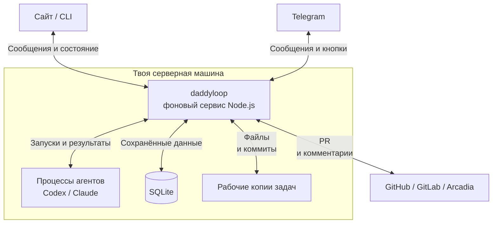
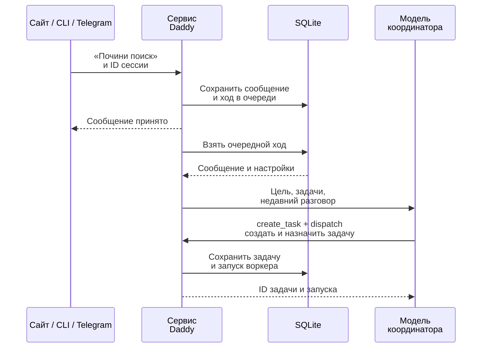
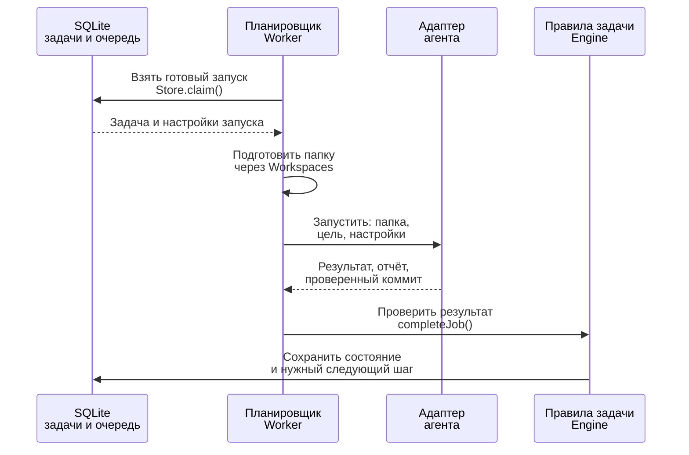
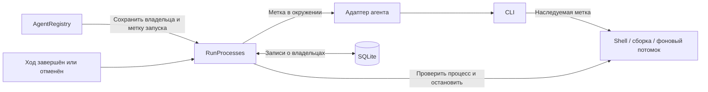
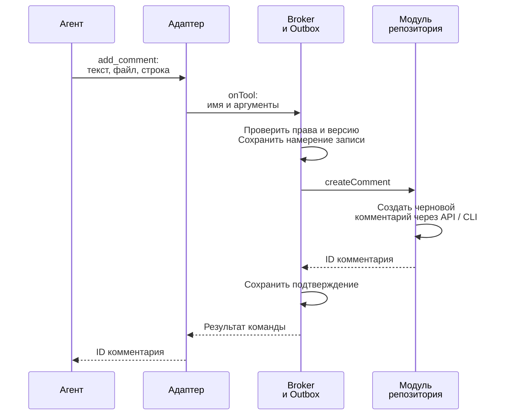
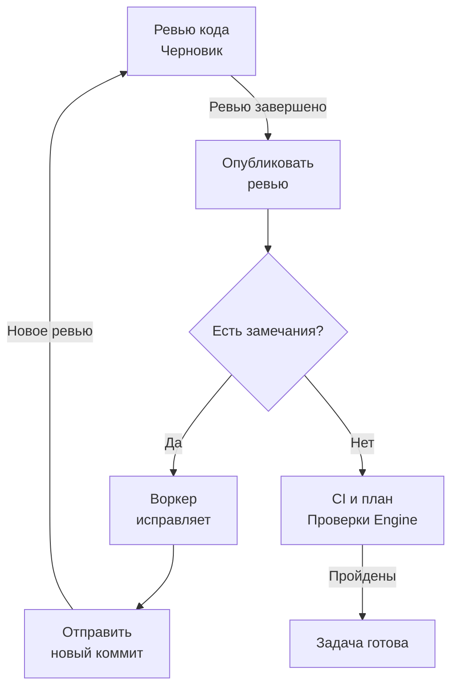
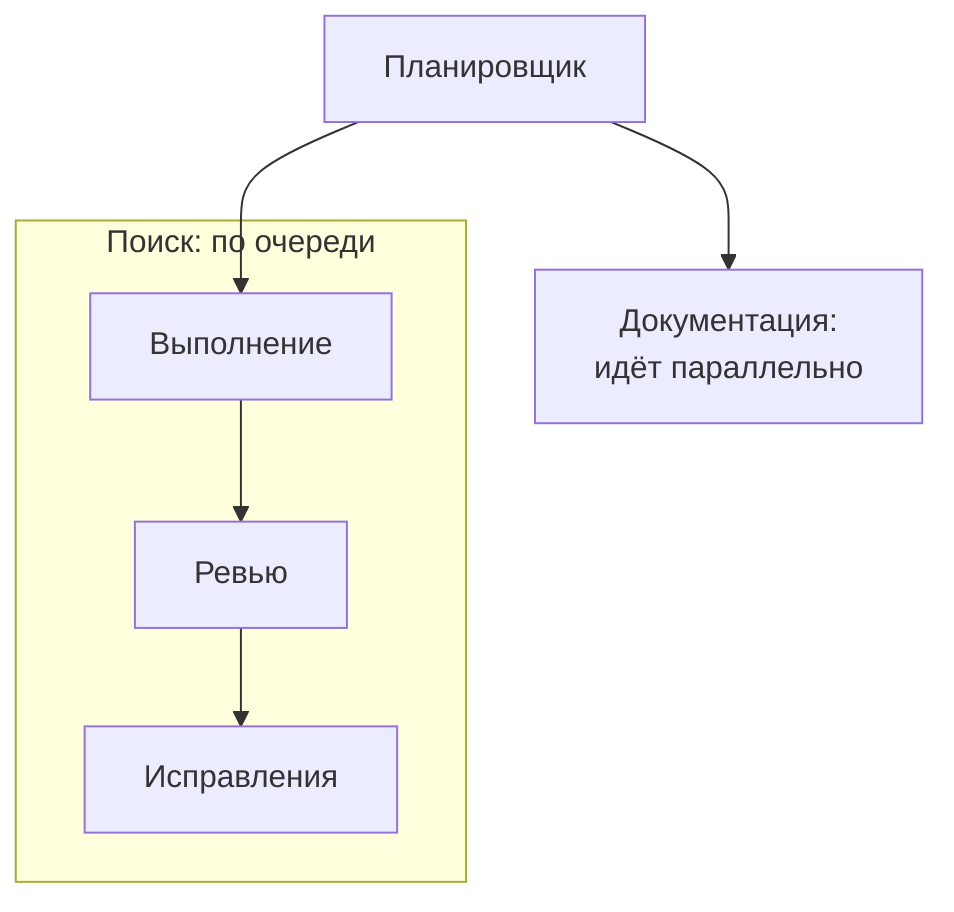
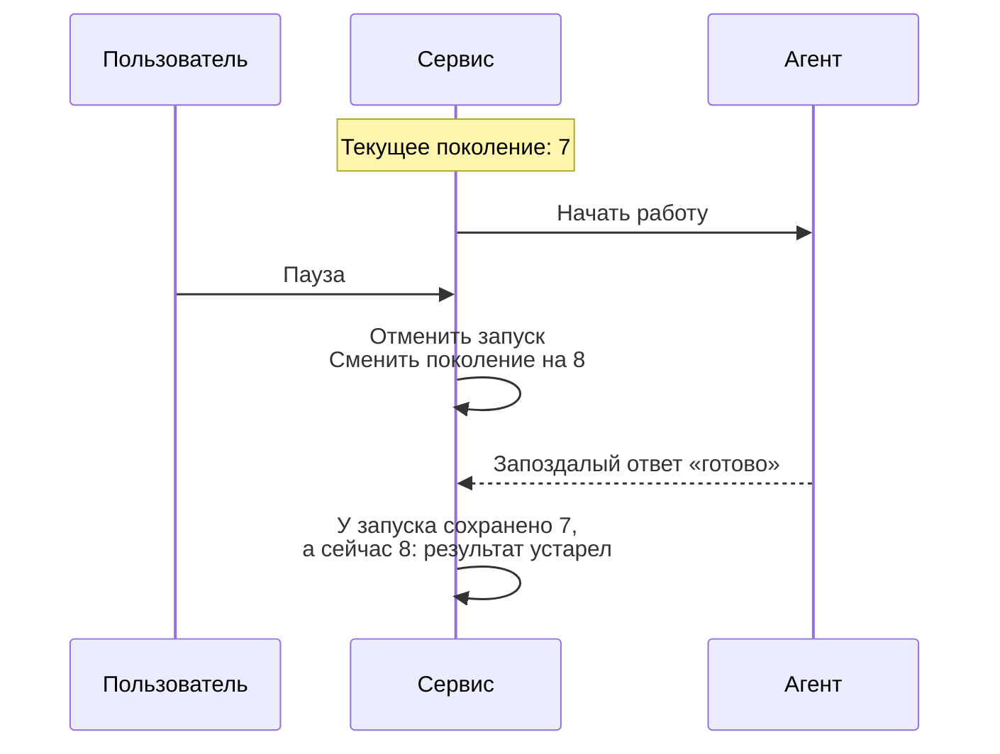

[English](en.md) · [Русский](ru.md) · [Все инструкции](../index/ru.md)

# Как устроен daddyloop

Сначала — общая схема. Дальше разобраны [создание задачи](#1-как-сообщение-превращается-в-задачу), [запуск агента](#2-как-запускается-агент), [инструменты и адаптеры](#3-как-агент-вызывает-инструменты), [цикл ревью](#4-как-замыкается-цикл-ревью), [параллельная работа](#5-какие-запуски-могут-идти-параллельно) и [отмена с восстановлением](#6-как-отмена-защищает-от-старых-результатов).

## Общая картина

Ты ставишь цель. daddy назначает работу воркерам и проверяет результат. Приложение запускает агентов, сохраняет историю и передаёт замечания на исправление.

Например, «Почини поиск» проходит путь: выполнение → ревью → исправления → повторная проверка. Ниже проследим эту задачу от сообщения до результата.



**Сайт, CLI и Telegram управляют одним сервисом на сервере.** Если закрыть ноутбук, сервис и агенты продолжат работу. Способы подключения описаны в [доступе к сайту](../web/ru.md).

Внутри сервиса `Daddy`, `Worker`, `Engine` и остальные компоненты — объекты одного Node.js-процесса. Они вызывают методы друг друга. Codex и Claude запускаются отдельными процессами; их протоколы скрыты в адаптерах.

## 1. Как сообщение превращается в задачу

Сервис сначала сохраняет сообщение. Затем запускает один ход координатора — обработку запроса моделью. Та может ответить тебе или назначить работу.



Сайт и CLI передают текст по HTTP. Для обычных сообщений Telegram сервис вызывает тот же `Daddy.chat()`. Подтверждение «принято» означает, что запрос сохранён. Ответ модели появится позже. Веб-клиент забирает обновления примерно раз в две секунды.

Кнопка **Поставить в очередь** на сайте и команда `/task` в Telegram вызывают одну операцию сервиса. Она сохраняет задачу и её первый запуск вместе. Повтор того же запроса находит ту же задачу. Диспетчер может запустить её сразу, как только освободится воркер. Оба интерфейса показывают одни и те же ID задач и назначения воркеров.

Координатор получает цель, список задач и недавние сообщения. Старую переписку и подробности он запрашивает инструментами. Например, `create_task` создаёт «Почини поиск», а `dispatch` назначает выполнение. Перед этим сервис проверяет выбранный воркспейс, принадлежность задачи сессии и её зависимости.

После завершения работы воркера событие снова ставит ход координатора в очередь. Так он узнаёт о результате и может назначить следующую задачу или задать тебе вопрос.

Код: [приём HTTP-запроса](../../src/server/daddy.ts), [Daddy.chat(), tick(), onEvent() и проверка инструментов](../../src/core/daddy.ts), [создание задач из текста и тикетов](../../src/core/ticket-workflow.ts).

Сохранённые сообщения видны всем клиентам и привязанной теме Telegram. Через `onAssistantMessage` по ходу работы координатора приходят готовые публичные реплики; диагностика и инструменты идут отдельными событиями. Перед сохранением текста приложение проверяет поколение запуска. Источник сообщения пользователя сохраняется, чтобы не дублировать его в исходной теме Telegram.

## 2. Как запускается агент

**Сессия** — разговор с daddy и все его задачи. **Задача** — отдельный результат, например исправленный поиск. **Запуск** — один этап её выполнения: написать код, проверить его или исправить замечания. У одной задачи таких запусков бывает много.

Планировщик ищет готовый запуск в очереди, проверяет свободные места и ресурсы, затем готовит папку и вызывает агента. В коде этот планировщик называется `Worker`; он запускает модели обеих ролей.



**Папка.** Именованный воркспейс указывает на исходный репозиторий и область работы. `Workspaces` готовит отдельные копии для задачи, `ArcWorkspaces` делает это для Arcadia. В автоматическом режиме модуль репозитория готовит копию сессии до первого вызова модели, затем выделяет отдельные копии воркерам. Воркер меняет свою копию, ревьюер читает закреплённую версию кода. Для координации есть отдельная копия `DaddyWorkspace`. Исходную папку пользователя не переключают, незакоммиченные изменения не стирают.

Для URL Git модуль хостинга проверяет адрес и задаёт аутентификацию через `GitRepositoryTransport`. `Workspaces` узнаёт основную ветку и коммит, скачивает его в Git-базу задачи и создаёт worktree. Следующая задача получает свою базу и ветку; повторные запуски используют прежнюю копию. Локальный Git читается без fetch в исходную папку. Разделение показано на [схеме источника и копий](../workspaces/ru.md#один-источник-отдельные-воркеры).

**Настройки.** Профиль агента и инструкции сохраняются вместе с запуском в очереди. При первом назначении в сессии диспетчер учитывает указанный профиль задачи или воркера и сохраняет выбор вместе с запуском. Общая модель воркеров заменяет отдельные настройки мест и применяется к очереди. Уже начатые ходы воркеров завершаются на прежней модели. `AgentRegistry` выбирает адаптер по `profile.engine`.

**Результат.** Агент возвращает статус, отчёт и коммит, с которым работал. `Engine` сверяет их с задачей и репозиторием. Сообщения «готово» недостаточно: например, незавершённое ревью оставит задачу открытой.

В базе этим понятиям соответствуют `ReviewGroup` (сессия), `Task` (задача), `Job` (запуск по задаче) и `DaddyJob` (ход координатора).

Код: [Worker](../../src/runtime/worker.ts), [Store](../../src/core/store.ts), [типы данных](../../src/core/types.ts), [Git-копии](../../src/runtime/workspaces.ts), [Arc-копии](../../src/runtime/arc-workspaces.ts), [копия координатора](../../src/runtime/daddy-workspace.ts).

### Кто останавливает сборку после окончания хода



Закрыть CLI недостаточно: фоновая сборка может отделиться и продолжить удерживать рабочую копию. Сервис сохраняет владельца до запуска. Оба адаптера передают метку командам, поэтому потомков можно найти и после выхода родительского процесса. После завершения, ошибки или отмены сервис посылает SIGTERM, немного ждёт и при необходимости использует SIGKILL. Перед сигналом он проверяет пользователя, запуск ОС и время рождения процесса. Оставшиеся процессы отмечаются как ещё останавливающиеся; их файлы сохраняются.

Восстановление повторяет остановку подтверждённых собственных процессов до обращения к модели за планом уборки. После остановки оно может удалить одноразовый кеш запуска; активные задания, подменённые пути и маунты защищены. При старте службы оставшиеся процессы прошлых запусков обрабатываются до выдачи новой работы. См. [RunProcesses](../../src/runtime/run-processes.ts), [контракт адаптера](../module-development/ru.md) и [тесты жизненного цикла](../../tests/run-processes.test.ts).

## 3. Как агент вызывает инструменты

Допустим, ревьюер нашёл ошибку и хочет оставить комментарий. Он передаёт приложению команду с текстом и местом в коде. Путь этой команды:



`Broker` проверяет, что запуск ещё действителен, код не изменился и роль имеет право на команду. Воркеру нельзя создавать комментарии ревью или объявлять собственное исправление проверенным. Ответ — ID комментария или ошибка — возвращается агенту по тому же пути. Markdown комментария сохраняется.

`Outbox` нужен на случай потери ответа. **Если площадка создала комментарий, а соединение оборвалось, нельзя сразу создавать второй.** Сервис заранее записывает ID операции и её аргументы, затем ищет уже созданный результат. Если исход выяснить не удалось, он останавливает повтор и просит разобраться.

Адаптер переводит этот общий обмен в протокол конкретного CLI. Для Codex это JSON-запросы и ответы через стандартный ввод и вывод процесса — app-server JSON-RPC. Для Claude используются Agent SDK `query()` и MCP-инструменты. Остальное приложение получает одинаковые вызовы и результаты.

Общий интерфейс запуска из [runtime/agent.ts](../../src/runtime/agent.ts):

```ts
export interface AgentRuntime {
  run(input: AgentInput): Promise<AgentResult>;
}
export interface SessionRuntime {
  runSession(input: SessionInput): Promise<AgentResult>;
}
```

`run()` выполняет этап задачи, `runSession()` — ход координатора. На входе — папка, цель, профиль, инструкции, инструменты и сигнал отмены. На выходе — результат; через обработчики `onTool`, `onEvent` и `onSession` идут команды, ход работы и ID разговора для продолжения.

Модуль репозитория выбирает `RepositoryRegistry`: `ReviewProvider` работает с комментариями, `SubmissionBackend` — с созданием PR. Каталог моделей, лимиты и обновления CLI также принадлежат модулю агента. Полные контракты и пример подключения — в [руководстве по своим модулям](../module-development/ru.md).

Код: [AgentRegistry](../../src/modules/agents/registry.ts), [Broker](../../src/core/broker.ts), [Outbox](../../src/core/outbox.ts), [RepositoryRegistry](../../src/modules/repositories/registry.ts).

## 4. Как замыкается цикл ревью

Работа вроде создания тикетов может закончиться отчётом со ссылками на результат. Если ветка осталась на исходной базе, сервис сохраняет отчёт и ставит его на независимую проверку daddy. Задача завершается после сверки результата с исходными требованиями, поколением запуска и закреплённой ревизией. Затем daddy может поставить дальнейшую работу в очередь по отчёту.

Сохранённые изменения относительно исходной базы ветки сервис передаёт в PR через `TicketWorkflow`. Это относится и к коммитам, сохранённым в предыдущих запусках. Можно также сразу прикрепить существующий PR. Оба варианта проходят один цикл ревью.



**От ревью к исправлению.** `Engine.review()` ставит проверку в очередь. Ревьюер читает код и оставляет черновые комментарии. Сервис публикует ревью в конце проверки. Если GitHub-ревьюер сообщил о препятствии, проверенные служебные замечания публикуются как комментарии к проверенному коммиту. Они доступны воркеру сразу. При подтверждённом конфликте и включённом автослиянии закреплённый воркер сначала получает задание разрешить конфликт. Новый коммит требует полного независимого ревью. Координатор видит фактический вопрос ревьюера через read_task. Если в нём есть замечания, `Engine.reconcile()` создаёт запуск на исправление. Воркер получает опубликованный снимок; приватный черновик ему недоступен.

**От исправления к новому ревью.** Пусть ошибка найдена в коммите H1, а исправление сохранено в H2. После отправки H2 `Engine.completeJob()` делает задачу готовой к проверке. На следующем проходе планировщик запускает ревью заново. Именно этот переход замыкает цикл.

Сообщение воркеру во время отправки исправления сохраняется с задачей. После подтверждения коммита и публикации его ревью планировщик доставляет сообщение на текущей ревизии. Если воркер вернул незавершённое исправление без вопроса человеку и GitHub подтвердил конфликт, сервис сохраняет локальные правки в коммите, поручает тому же воркеру разрешить конфликт и отправляет результат на независимое ревью.

**Условие завершения.** Ревьюер должен учесть прежние замечания: подтвердить исправление либо записать решение снять, отложить или отклонить замечание. Затем нужны пустое опубликованное ревью и проверки, заданные правилами задачи: CI, а для плана — одобрение. При включённом автослиянии GitHub планировщик повторно проверяет опубликованное ревью, CI и ревизию PR. В запрос слияния передаётся проверенный SHA. Журнал операций позволяет сверить результат после потери ответа. При подтверждённом конфликте планировщик назначает воркеру объединение веток. Рабочая копия привязана к коммитам PR и целевой ветки. Сервис отправляет коммит с обоими родителями в тот же PR и запускает независимое ревью новой ревизии.

При переполнении контекста ревьюера Codex адаптер возобновляет тот же поток и запрашивает сжатие истории. После завершения сжатия ревью продолжается на проверяемой ревизии. Если поток по-прежнему недоступен, для GitHub-задач с автослиянием остаётся повторная попытка в новом потоке. Черновик и разговор с координатором сохраняются. Подробнее в [протоколе Codex app-server](https://developers.openai.com/codex/app-server#trigger-thread-compaction).

После подтверждения сохранённого исправления на новом коммите старый черновик GitHub может блокировать создание ревью. Для задачи с автослиянием сервис архивирует Markdown своего черновика в SQLite перед удалением. Для замены он сверяет владельца, служебную метку, версию, отсутствие комментариев и совпадение текста с исходной заглушкой или подтверждённой записью сводки. Неизвестные правки остаются в GitHub. Новый черновик привязан к подтверждённому коммиту и требует полного ревью.

При включённом автослиянии успешное ревью и проверки переводят задачу в `awaiting_merge`. Воркер сохраняет место на время исправления конфликтов и освобождает его при подтверждённом завершении задачи. Зависимые задачи также ждут завершения.

Сервис автоматически публикует завершённое ревью и отправляет сохранённый коммит после сверки ревизии PR. Незавершённая проверка и спор оставляют задачу открытой. Ревью продолжается, пока есть прогресс. При повторении одних и тех же замечаний цикл ждёт решения. Упавший CI тоже оставляет задачу ждать и сам по себе не запускает починку CI.

Код: [переходы Engine](../../src/core/engine.ts), [планировщик Worker](../../src/runtime/worker.ts), [отправка PR](../../src/core/ticket-workflow.ts). В [тестах цикла](../../tests/worker.test.ts) проверяется путь от ревью до исправления и новой проверки.

Воркер сохраняет коммит исправления и исходную ревизию под блокировкой задачи. Сервис отправляет этот коммит и сверяет его с вершиной PR перед следующим ревью. При смене целевой ветки или неподтверждённой отправке в карточке остаётся хеш сохранённого коммита. Прежний черновик ревью доступен для проверки.

Например, после публикации замечаний GitHub ещё может вычислять, сливается ли PR. Сервис ждёт результата. Если GitHub подтвердит конфликт, закреплённый воркер получит одно задание на объединение веток. Тот же выбор действует при запуске ревью и при последней проверке перед слиянием. Если конфликтов нет, воркер исправляет опубликованные замечания. Запрос слияния требует свежего опубликованного ревью без замечаний и зелёного CI для проверенной ревизии. При неизвестном результате предыдущей отправки сервис сначала сверяет её с GitHub.

Порядок действий задан в [nextPrAction](../../src/core/pr-routing.ts). [Engine](../../src/core/engine.ts) сохраняет черновик или локальные правки и назначает воркера. [Автослияние](../../src/core/auto-merge.ts) повторно применяет это правило после чтения ревью и перед записью в GitHub. [Регрессионные тесты](../../tests/auto-merge.test.ts) проверяют эти входы на одном сценарии.

При временной ошибке чтения GitHub планировщик сохраняет время повтора и постепенно увеличивает интервал. Если PR уже создан, сервис помнит его адрес, отправленный коммит и поколение задачи и повторяет только чтение для привязки. Если ответ на создание PR потерялся, daddy ищет исходный PR по метке задачи, ветке и автору. В очереди видны время следующей попытки или конкретный вопрос владельцу.

Если при исправлении конфликта истёк лимит времени, тот же воркер продолжает с сохранёнными файлами. Первая пауза перед повтором — 30 секунд, последующие — пять минут. Если целевая ветка продвинулась, сервис проверяет родство коммитов до продолжения и отправляет результат на ревью относительно актуальной базы.

## 5. Какие запуски могут идти параллельно

**По одной задаче одновременно работает один запуск агента.** Пока воркер выполняет «Почини поиск», второй запуск по этой задаче ждёт. Другая задача — например, обновление документации — может идти параллельно.



Так два запуска не правят одну рабочую копию одновременно, а ревью начинается после завершения предыдущего этапа. **Задача и запуск — разные вещи:** одна задача может пройти пять запусков за свою жизнь, но в конкретный момент работает только один из них.

Это проверяется в `Store.claim()`: планировщик пропускает задачи, у которых уже есть работающий запуск. Выбор из очереди и отметка «работает» сохраняются вместе. База дополнительно запрещает второй работающий запуск с тем же ID задачи — для этого нужен индекс `one_running_per_task`.

Есть ещё два ограничения. В одной сессии ревью идут по очереди; её координатор и ревьюер также не работают одновременно. У них один профиль модели, но разные истории разговоров. На весь сервер задан предел одновременных запусков по задачам (`worker.maxAgents`, включая ревью); отдельно допускается один ход координатора.

**Уменьшение пула ждёт завершения задач.** Если изменить размер с трёх до одного, текущие задачи сохранят свои места. Они заняты до конца ревью, исправлений и проверок, даже во время паузы. Новые задачи ждут свободного места в уменьшенном пуле. Зависимость «A перед B» тоже задерживает B, но не переносит в неё изменения из ветки A.

Код: [выбор запуска и запрет дублей](../../src/core/store.ts), [пул воркеров](../../src/core/worker-pool.ts), [общий ревьюер](../../src/runtime/worker.ts).

Воркеры сохраняют номера, пока за ними закреплены задачи. При явном выборе номера задача ждёт этого воркера. Если заданы модель и уровень рассуждений, диспетчер ищет свободного воркера с таким профилем или задаёт этот профиль первому свободному. При принудительной смене профиля сервис отменяет текущую попытку автора, повышает поколение задачи и ставит тот же шаг в очередь с прежней рабочей копией. Замена запустится после остановки предыдущей попытки.

## 6. Как отмена защищает от старых результатов

При паузе сессия запоминает, какие задачи и запуски она остановила. После снятия паузы возвращаются прежние состояния и порядок очереди, в том числе после перезапуска сервиса. Задачи, остановленные отдельно, сохраняют паузу. Воркер продолжает в прежней рабочей копии, а незавершённое ревью снова проходит проверку.

Отмена может прийти, когда агент уже отправляет ответ. Поэтому одного сигнала «остановись» недостаточно: сервис должен ещё проверить, имеет ли старый запуск право изменить задачу.



**Старый результат не продвигает задачу.** Поколение (`generation`) — счётчик отмен, который сервис сохраняет вместе с запуском. После паузы номера расходятся. `Engine.completeJob()` игнорирует такой результат, а `Broker.call()` запрещает этому запуску менять комментарии. Файлы и история при этом сохраняются.

Если целевая ветка продвинулась до запуска ревью GitHub или во время него, daddy может сохранить свой черновик на том же коммите PR и сразу назначить повторную проверку. Это работает и при выключенном автослиянии. Публикация требует результата нового ревью. Для черновика с замечаниями сервис сверяет автора, сводку и каждый комментарий с журналом подтверждённых операций. Перед публикацией ревьюер проверяет весь результат, обновляет или снимает оставшиеся замечания и заново записывает сводку. Неизвестные правки остаются в черновике для проверки.

Воркер продолжает исправлять опубликованные замечания на закреплённом коммите PR, если GitHub подтвердил продвижение той же целевой ветки без переписывания истории. Перед отправкой daddy ещё раз сверяет исходную и целевую ветки. Новый коммит проходит независимое ревью. Вопрос координатора по задаче, которая уже ждёт ответа, остаётся в истории сессии. События остальных задач по-прежнему запускают координатора.

Черновые комментарии GitHub редактируются и снимаются по идентификатору узла в конкретном ревью. После потери ответа сервис сверяет запрошенный текст с текущим комментарием. Старый отказ REST с кодом 404 снимается с ожидания после сверки комментария с подтверждённой записью. Техническое ожидание не вызывает упоминание владельца в Telegram.

После перезапуска сервиса daddy сверяет прерванное ревью GitHub с черновиком и журналом подтверждённых записей перед повторной проверкой. Для прерванного исправления он проверяет опубликованные замечания, коммит PR, целевую ветку и незавершённые операции, затем возвращает воркеру его рабочую копию.

Если перед исправлением конфликта в рабочей копии GitHub остались правки и задача охватывает весь репозиторий, сервис сохраняет копию целиком и готовит рядом новую на ожидаемом коммите. Тот же воркер может сверить добавленные в индекс и неотслеживаемые файлы при разрешении конфликта. Сохранённая копия доступна и после повторного запуска.

Проверка версии кода решает похожую проблему: ревью H1 не подтверждает исправление в H2. Сервис сравнивает весь набор версии и базы сравнения (`head`, `base`, `start`, `revisionId`). Изменение кода сбрасывает старое ревью, одобрение плана и ручной пропуск CI. Оставшийся старый черновик требует разбора.

При сбоях действуют те же правила:

- **Один сервер на каталог данных:** сервер и бекапы берут одну файловую блокировку ОС. Ядро освобождает её при завершении процесса, поэтому пустой PID-файл после переполнения диска не считается работающим сервером. [Реализация](../../src/ops/data-lock.ts) и [проверки аварийного завершения](../../tests/data-lock.test.ts).
- **Перезапуск сервиса:** база хранит задачи, очереди и историю. Прерванная работа сохраняется как прерванная; координатор может разобрать её и продолжить разрешённые шаги.
- **Нехватка памяти или диска:** новые запуски ждут, активные могут быть прерваны с сохранением работы.
- **Запись уже ушла в репозиторий:** пауза не удалит созданный комментарий и не откатит push. Сервис сверяет внешний результат перед продолжением.
- **Перенос бекапа:** данные и рабочие файлы переносятся, незавершённые задачи восстанавливаются на паузе. Разговоры внутри CLI начинаются заново — см. [бекапы](../backups/ru.md).

Удаление сессии сначала отменяет её запуски и ждёт их остановки. Модуль репозитория сохраняет и проверяет архив результатов, затем удаляет свои копии. Ошибка сохранения оставляет копии на месте. См. [источники, копии и удаление](../workspaces/ru.md) и [жизненный цикл Arcadia](../arcadia/ru.md).

Код: [отмена, смена ревизии и восстановление](../../src/core/engine.ts), [восстановление координатора](../../src/core/daddy.ts), [проверки ресурсов](../../src/core/resources.ts). Сборка всех компонентов начинается в [buildApp()](../../src/server/app.ts).

По умолчанию агенты выполняют команды под пользователем сервиса на хосте (`agentExecution: "host"`), с его DNS и локальными сокетами. Явный sandbox — отдельная настройка, не роль в рабочем процессе. Telegram сохраняет доставки до отправки, объединяет один ход в редактируемую карточку и повторяет ошибки независимо от запуска модели. Название темы обновляется по событию переименования сессии.
