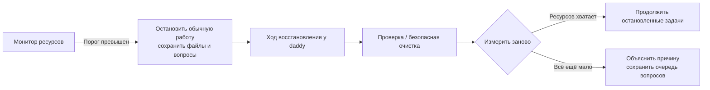

[English](en.md) · [Русский](ru.md) · [Все инструкции](../index/ru.md)

# Эксплуатация сервиса

```bash
daddy service status
daddy service logs --follow
daddy up
daddy down
daddy restart
```

Linux-сервис systemd работает от твоего пользователя. На unified cgroups используется пользовательский manager с lingering, на других поддерживаемых хостах — системный unit с явными user/group. Постоянную приватную сеть обеспечивает отдельный сервис Tailscale. Приложение не зависит от tmux, браузера ноутбука или SSH-сессии.

Штатная остановка прерывает ходы агентов и записывает незавершённую работу для восстановления. После сбоя также отсекаются прерванные поколения. Посмотри отчёт задачи и продолжи через daddy: перезапуск не превращает незавершённое ревью в успешное. Потерянный ответ нативной операции сначала восстанавливается, затем разрешается повтор.

После сбоя systemd повторяет запуск каждые 30 секунд до успеха, в том числе после освобождения переполненного диска. Явный `daddy down` оставляет службу выключенной. Сервер и команда бекапа используют общую файловую блокировку ОС: она освобождается при завершении процесса, даже принудительном. Пустой или устаревший `server.lock` не мешает запуску; не удаляй его, пока работает служба или бекап.

## Файлы и аккаунты

- Конфиг: `~/.config/daddyloop/config.json`; переопределяется через `DADDYLOOP_CONFIG`.
- Данные: настроенный `dataDir`, по умолчанию `~/.local/share/daddyloop/data`.
- База: `daddyloop.sqlite`, включён WAL. Текущая схема — **7**, формат конфига — **3**.
- Релизы: `~/.local/share/daddyloop/releases/`; `current` выбирает неизменяемый вариант установки.
- Токены: `~/.tokens/github`, `~/.tokens/gitlab`, `~/.tokens/tracker` или соответствующие переменные окружения провайдера. Содержимому токенов не место в Git.
- Пути CLI: `executables.<id-модуля>` в конфиге. Модуль Codex также принимает `DADDYLOOP_CODEX_BIN`.

Основной вход в браузер использует локальный `access-token`. HTTPS-привязка создаёт отдельные отзываемые учётные данные браузера. `daddy devices` показывает устройства, `daddy revoke-device ID` отзывает одно, `daddy phone` создаёт новую одноразовую ссылку. См. [доступ к сайту](../web/ru.md).

В режиме host daddy и воркеры могут использовать существующие токены для своей задачи. Прежде чем сообщать об отсутствии авторизации, они проверяют имена файлов в `~/.tokens` и инструкцию нужного инструмента. Инструмент читает подходящий файл локально; если ему нужна переменная окружения, локальный скрипт передаёт её дочернему процессу. Секреты не должны попадать в чат, промпты модели, вывод команд или файлы репозитория. Копировать все токены в окружение службы не требуется.

## Ресурсы и очистка

По умолчанию служба и её сборки могут использовать память хоста: `memoryMax: "infinity"`. daddyloop также не ограничивает число процессов и потоков. Монитор по-прежнему сохраняет запас 2 ГиБ доступной ОЗУ и 10 ГиБ диска, останавливает обычную работу при 90% занятого диска. Контейнер или родительский unit systemd могут задавать свои ограничения; монитор показывает реально доступную память.

Явный лимит можно задать в конфиге, например `memoryMax: "24G"`. При обновлении сохраняется существующая настройка: замени старое `"8G"` на `"infinity"`, чтобы использовать память хоста. После завершения активной работы примени настройки службы командой `daddy up`. Снятие лимита службы сохраняет проверки свободного места и запаса ОЗУ.

```bash
daddy cache status
daddy cache prune          # только посмотреть
daddy cache prune --apply  # удалить проверенные подходящие записи
daddy cache auto on
```

Очистка рассматривает только собственные временные загрузки и старые чистые управляемые копии для ревью. Активная, изменённая, неотправленная, неизвестная работа и копии воркеров защищены. Безопасная автоочистка по умолчанию включена; явное `cache.auto: false` запрещает автоматическое удаление. После изменения политики перезапусти сервис. Большой размер сам по себе не разрешает удаление кеша.

Перед тяжёлой работой проверяй `df -h /home` и доступную ОЗУ. Для Arcadia store/mount сначала проверяется владелец; обычная очистка не должна обрезать store. `daddy cache arcadia-gc` — явный обычный GC, а не удаление чужой работы.

### Плановая уборка

В вебе открой **Очистка диска** в боковом меню. В личке бота открой **Настройки → Очистка диска** или отправь `/cleanup`. Кнопкой можно включить или выключить расписание. Команды `/cleanup threshold 89`, `/cleanup interval 30` и `/cleanup skill /путь/к/SKILL.md` задают порог, интервал и скилл. Веб и Telegram применяют изменения сразу и сохраняют их после перезапуска.

Плановая уборка включается отдельно. Она проверяет диск с каталогом данных даже без открытых сессий. При превышении порога уборка идёт в фоне. Интервал между проверками составляет не менее 30 минут. Порог уборки по умолчанию составляет 80%, аварийный порог для обычной работы задаётся отдельно.

```bash
daddy cache schedule --enable --interval-minutes 30 --disk-percent 80 --pause-percent 90
daddy restart
daddy cache schedule
```

В статусе видны время следующей проверки и результат последней уборки. Сервис измеряет заполнение и свободное место до и после очистки. Когда диск возвращается к заданному порогу, очистка прекращается. При включённых уведомлениях отчёт приходит в личку Telegram. Команда `daddy cache schedule --disable` отключает расписание после перезапуска. Общий переключатель `daddy cache auto off` отключает автоматическую очистку кэшей, включая плановую.

Для отдельного скилла укажи Markdown-файл или папку с `SKILL.md`. Сервис сохраняет снимок текста и передаёт агенту список разрешённых операций. Агент выбирает порядок и может пропустить операцию. Проверку и удаление выполняет сервис. Если агент не выдал допустимый план, попытка заканчивается ошибкой в статусе.

```bash
daddy cache schedule --skill-file ~/skills/cache-cleanup/SKILL.md
daddy restart
```

Можно зарегистрировать выделенный каталог с воспроизводимыми файлами кэша на том же диске. В примере допускаются только обычные файлы с именами, начинающимися на `build-`, которые не читались и не менялись семь дней. Команда регистрации сохраняет локальное разрешение в самом каталоге. Сервис проверяет его, владельца, путь и пересечения с данными сессий перед очисткой. Каталоги, ссылки и файлы с другими именами сохраняются.

```bash
daddy cache target add ~/.cache/my-build --prefix build- --age-days 7
daddy restart
```

Команда `daddy cache target remove ~/.cache/my-build` убирает каталог из расписания после перезапуска.

Для штатного GC большого кеша администратор может установить системную службу вида daddyloop-cleanup-example.service с Type=oneshot и RemainAfterExit=no. В окружении службы daddy переменная DADDYLOOP_CLEANUP_UNITS перечисляет разрешённые имена через запятую. После перезапуска они видны в настройках уборки и доступны скиллу как идентификаторы без суффикса .service. Для каждого имени пользователю службы нужно право выполнить sudo -n /usr/bin/systemctl start с этим именем. Команды, владельца кеша и проверку занятости задаёт сама служба. Код выхода 75 с SuccessExitStatus=75 обозначает пропуск. Перед следующей операцией daddy снова проверяет порог.

Чтобы systemd сохранял результат завершённого процесса, добавьте имена служб уборки в директиву After= секции [Unit] у работающей службы daddy. Это задаёт порядок запуска; расписание по-прежнему запускает уборку только при превышении порога. Для AssertHost= указывайте имя хоста из uname -n. Отчёт показывает пропущенное условие запуска или отсутствие подтверждения, если сведения о процессе недоступны. Для подтверждённого запуска отдельно показано изменение свободного места на разделе.

### Восстановление вместо молчащей очереди



Монитор проверяет диск и RAM даже без работающих агентов. Он назначает один ход восстановления модели daddy из этой сессии, в отдельной папке и разговоре. Доступны проверка ресурсов, очистка проверенного кеша приложения и освобождение простаивающих ресурсов через модули репозиториев. Arcadia может выполнить обычный `arc gc` и отключить собственные простаивающие копии, сохранив store и изменения. Чужие копии в очистку не входят.

Обычная работа по-прежнему ждёт ресурсов. Для восстановления нужны хотя бы 1 ГиБ диска и 0,5 ГиБ доступной RAM; ниже этого порога бот объясняет, почему не может стартовать. Неудачное восстановление повторяется не чаще раза в пять минут. Вопросы сохраняются. После повторного измерения продолжаются только задачи, остановленные монитором, если их поколение не изменилось. Ручная пауза сохраняется.

Каждый запуск агента владеет своими командами, включая отделившиеся фоновые процессы. После завершения, ошибки или отмены хода сервис посылает им SIGTERM, ждёт завершения и при необходимости использует SIGKILL. Он сохраняет владельца и проверяет пользователя, запуск ОС и время рождения процесса; одно имя `bash`, `rsync` или компилятора не разрешает его остановку. Агент должен дождаться необходимых сборок и тестов до окончания хода.

Восстановление останавливает проверенные оставшиеся процессы **до обращения к модели**. Если этого хватило, модель обслуживания не запускается. Иначе инструменты могут повторить остановку и удалить одноразовый кеш законченных запусков из `dataDir/run-cache`. Активные задания, чужие процессы, рабочие копии и уникальные результаты защищены. Владение сохраняется после перезапуска службы; бекап не переносит данные о живых процессах. Перед отправкой запоздалого отчёта об уборке сервис проверяет ресурсы ещё раз: снятый блокер не превращается в новую просьбу убивать процессы вручную.

## Обновление и удаление

Перед заменой версии приложения заверши или приостанови работу и сохрани конфиг с базой. Запусти установщик нужного релиза с полным списком модулей. Прежние форматы конфига и базы требуют явного преобразования: runtime их не угадывает и не мигрирует. Резервная копия не является слоем совместимости.

`daddy service uninstall` удаляет сервис приложения, сохраняя данные и токены. Отдельно установленная сеть остаётся отдельным сервисом. В системном режиме изменение сервисов может требовать sudo. Обновления CLI агентов сохраняют работающие ходы — см. [агенты](../agents/ru.md).

Переносимый снимок описан в [бэкапах и восстановлении](../backups/ru.md). Перед `daddy backup create` останови сервис; восстанавливай только в новый каталог.
