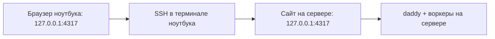

[English](en.md) · [Русский](ru.md) · [Все инструкции](../index/ru.md)

# Как открыть сайт на компьютере или телефоне

Сайт работает **на машине с сервисом**, по адресу `http://127.0.0.1:4317`. Браузеру нужен путь к этой машине. Ставить CLI на ноутбук необязательно.

В настройках сессии профиль «Все воркеры» применяется ко всем местам, включая индивидуально настроенные. Уже начатый ход воркера дорабатывает на прежней модели, следующий использует новую. Для немедленной смены модели daddy выберите «Применить сейчас»: активный ход координатора или ревью продолжится на новой модели. В Telegram эти кнопки доступны через /models.

## Где что находится

| Место                       | Что здесь делать                                                                     |
| --------------------------- | ------------------------------------------------------------------------------------ |
| Linux-сервер с daddyloop    | Установить модули, выполнить `daddy up`, подключить аккаунты                         |
| Локальный терминал ноутбука | Запустить SSH-туннель к серверу                                                      |
| Браузер ноутбука            | Открыть адрес локального конца туннеля и войти                                       |
| Телефон                     | Подключиться напрямую к серверу через Tailscale/HTTPS; для Telegram туннель не нужен |



Если приглашение терминала уже показывает удалённую машину, ты внутри SSH. Для команды туннеля открой **новую локальную вкладку терминала** на ноутбуке. `127.0.0.1` означает «эта машина», поэтому открыть его на ноутбуке без туннеля недостаточно.

## Компьютер: быстрый доступ через SSH

1. На сервере выполни `daddy up`, затем `daddy web`.
2. Скопируй SSH-команду из вывода `daddy web` в **новый локальный терминал ноутбука**. Пользователь, хост, порт сайта и определённый SSH-порт сервера уже подставлены.
3. Открой адрес сайта, напечатанный рядом с командой. Терминал с туннелем оставь открытым.
4. На сервере выполни `daddy token` и вставь токен в форму входа на сайте.

Если daddy установлен на ноутбуке, сервер покажет и короткую команду `daddy web --ssh` с нужным адресом. Она сама запускает туннель, ждёт ответа сайта и открывает локальный браузер, если он доступен. Ctrl+C закрывает только туннель. SSH использует твои обычные ключи, агент и конфиг.

Сервер не может запустить процесс на отключённом ноутбуке. Напечатанную команду нужно выполнить на ноутбуке. `daddy open` внутри SSH теперь показывает эти же инструкции вместо попытки открыть браузер на сервере. `daddy up` тоже печатает их после запуска сервиса.

### Другой адрес или занятый порт ноутбука

На сервере `daddy web --host work-host --port 14317` напечатает команды с твоим SSH-алиасом и локальным портом 14317. Порт сервиса останется прежним. При запуске CLI на ноутбуке `--remote-port` задаёт порт сайта на сервере, а `--ssh-port` — нестандартный порт SSH.

Туннель слушает только локальный адрес ноутбука. При его закрытии браузер потеряет связь; **daddy и воркеры продолжат работу на сервере**. Для повторного подключения выполни ту же команду. Для телефона и постоянного адреса настрой приватный HTTPS, как описано ниже.

### Быстро проверить соединение

В отдельном терминале сервера: `curl -fsS http://127.0.0.1:4317/api/health`. В локальном терминале ноутбука при открытом туннеле — та же команда (или порт `14317`). Оба ответа должны содержать `"ok":true` и одну версию сервиса. Первый работает, второй нет — проблема в SSH/туннеле. Оба работают, но вход не удаётся — проверь токен и адрес браузера.

## Браузер на самой машине с сервисом

Открой [http://127.0.0.1:4317](http://127.0.0.1:4317) или выполни `daddy open` на этой машине. Для входа нужен `daddy token`. Внутри SSH команда `daddy open` печатает инструкции подключения ноутбука.

## Компьютер и телефон: постоянный приватный доступ

На сервере:

```bash
daddy web tailscale
```

Пройди вход в аккаунт по выданной ссылке. Установи Tailscale на ноутбук или телефон и подключись к той же сети. Команда запускает Tailscale Serve как постоянный сервис и сохраняет HTTPS-адрес. Посмотреть адрес и получить вход:

```bash
daddy web status
daddy phone
```

`daddy phone` выдаёт одноразовую ссылку входа в браузер на пять минут. На компьютере она тоже работает. Открой её на нужном устройстве, подключённом к приватной сети. Телефон ходит прямо на сервер: ноутбук и SSH-сессия могут быть выключены.

## Собственный HTTPS-домен

Настрой домен и HTTPS-прокси на сервер. Проксируй на `127.0.0.1:4317`, сохраняй Host и отключи буферизацию потока событий. Затем на сервере:

```bash
daddy web origin https://daddy.example.com
daddy restart
daddy phone
```

Пример для Caddy:

```caddyfile
daddy.example.com {
    reverse_proxy 127.0.0.1:4317 {
        flush_interval -1
    }
}
```

Само приложение продолжает слушать loopback. Настроенный public origin должен точно совпадать с адресом браузера. Доступность извне определяется прокси и сетью.

## Если страница не открывается

- `daddy service status` на сервере: сервис должен быть активен.
- Для SSH проверь, что туннель открыт и локальный порт свободен.
- Для Tailscale оба устройства должны быть в одной сети; сначала заверши вход на сервере.
- Посмотри URL через `daddy web status`. `localhost` на телефоне означает сам телефон.
- После смены HTTPS-адреса перезапусти daddyloop. Одноразовая ссылка могла истечь или уже использоваться — выпусти новую.

## Темы

Нажмите **Выбрать тему** в настройках внизу боковой панели. На узком экране сначала откройте меню **Сессии**. На экране входа доступен значок палитры. В веб-интерфейсе восемь тем.

| Светлые | Тёмные  |
| ------- | ------- |
| Лёд     | Графит  |
| Жемчуг  | Полночь |
| Мята    | Хвоя    |
| Сирень  | Слива   |

Режим **Как в системе** выбирает Лёд для светлого оформления и Графит для тёмного. Выбранная в браузере тема применяется во всех сессиях, сохраняется после перезагрузки страницы и синхронизируется между вкладками. На телефоне можно выбрать другую тему. Смена цветов не меняет задачи, черновики, модели или настройки сервера.

Палитры сайта охватывают разговор, доску задач, диалоги, формы и вход. У терминала отдельные варианты: `daddy --theme dark` и `daddy --theme light`.

Наведите указатель на значок лимитов в верхней панели или перейдите к нему клавишей Tab, чтобы увидеть остаток квот. Нажмите на значок, чтобы открыть подробности и перейти на [страницу лимитов](../agents/ru.md#лимиты). Логи и отзыв доступа устройств описаны в [эксплуатации](../operations/ru.md).

## Типографика интерфейса

Веб-интерфейс использует Inter для русского и английского текста. Выбирайте [стиль из общей шкалы](../../src/ui/typography.css) по назначению текста. Каждый стиль задаёт размер, межстрочный интервал и начертание вместе.

| Стиль     | Размер / межстрочный интервал | Начертание | Где использовать                                            |
| --------- | ----------------------------- | ---------- | ----------------------------------------------------------- |
| `caption` | 12 / 18 px                    | 400        | Время, счётчики и короткие примечания                       |
| `status`  | 12 / 18 px                    | 600        | Статусы и бейджи                                            |
| `help`    | 13 / 19,5 px                  | 400        | Подсказки к полям и ошибки                                  |
| `label`   | 13 / 19,5 px                  | 600        | Подписи полей и кнопки                                      |
| `body`    | 14 / 21 px                    | 400        | Описания                                                    |
| `item`    | 14 / 19,6 px                  | 600        | Названия задач, сессий и воркспейсов в списках              |
| `reading` | 16 / 25,6 px                  | 400        | Сообщения и текст в полях                                   |
| `section` | 16 / 21,6 px                  | 600        | Заголовки разделов                                          |
| `title`   | 20 / 26 px                    | 600        | Заголовки страниц и диалогов, название задачи в её карточке |
| `brand`   | 24 / 30 px                    | 700        | Название приложения в логотипе                              |
| `display` | 32 / 38,4 px                  | 600        | Заголовок экрана приветствия                                |

Значения в таблице приведены для базового размера браузера 16 px. В CSS размеры заданы в `rem`, а межстрочные интервалы — множителями. При изменении размера текста в браузере они масштабируются вместе. Для кода и путей используйте моноширинный шрифт с размером подходящего стиля.

Используйте одну шкалу на телефоне и компьютере. Разрешайте перенос строк для названий в списках, заголовков диалогов и подсказок. В компактной шапке сессии заголовок может занимать до двух строк, а название воркспейса — до одной. Полный текст обоих названий доступен в списке сессий. Проверяйте новый текст на узком и широком экранах на обоих языках, включая длинные названия и многострочные подсказки.
